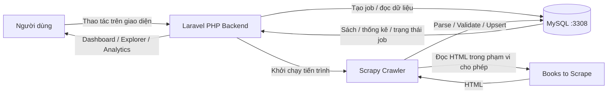

<div align="center">


# CrawlInsight

### Thu thập dữ liệu thông minh · Khám phá thông tin trực quan

**Nền tảng Web Crawling giúp biến dữ liệu phân tán trên website thành thông tin có cấu trúc, dễ tìm kiếm, theo dõi và phân tích.**

*Web Crawling & Book Data Analytics Platform*


**[Tổng quan](#-tổng-quan)** · **[Tính năng](#-tính-năng-nổi-bật)** · **[Cách hoạt động](#-cách-crawlinsight-hoạt-động)** · **[Cài đặt](#-chạy-dự-án-trên-máy-cá-nhân)** · **[Nhóm phát triển](#-nhóm-phát-triển)**

</div>

---

## 🌟 Tổng quan

Mỗi ngày, thông tin trên web được trình bày dưới nhiều cấu trúc HTML khác nhau. Nếu cần thu thập và phân tích nhiều trang, việc sao chép bằng tay vừa tốn thời gian vừa khó quản lý. **CrawlInsight** được xây dựng để thể hiện một quy trình Web Crawling có tổ chức: **truy cập nguồn được phép → phân tích HTML → chuẩn hóa → lưu trữ → tìm kiếm và trực quan hóa dữ liệu**.

Sản phẩm hiện tập trung vào dữ liệu sách từ [Books to Scrape](https://books.toscrape.com/) — một website sandbox dành cho việc học và thực hành web scraping. Nhóm lựa chọn nguồn này để có thể tập trung vào cơ chế kỹ thuật, xử lý dữ liệu và trải nghiệm người dùng, thay vì tìm cách vượt qua các biện pháp hạn chế của website thương mại.

**Điểm khác biệt của dự án:** Không dừng lại ở một script lấy tiêu đề và giá sách, CrawlInsight xây dựng một **ứng dụng web đa người dùng**, nơi kết quả crawling có thể được khám phá qua giao diện hiện đại, lưu sách quan tâm, theo dõi các lượt thu thập và phân tích dữ liệu.

> [!NOTE]
> Đây là **dự án học thuật đang phát triển và kiểm thử**, chưa phải dịch vụ công khai/production. Chức năng đã có mã nguồn không đồng nghĩa tất cả luồng chạy thật đã được nghiệm thu. Nguồn sách, giá và đánh giá trên Books to Scrape là dữ liệu thử nghiệm; giá hiển thị theo **GBP**, không tự quy đổi sang VND.

## ✨ Tính năng nổi bật

| Nhóm chức năng | Trải nghiệm trong CrawlInsight |
|---|---|
| 🏠 **Trang giới thiệu** | Giới thiệu mục đích, lợi ích, cách hoạt động và hướng dẫn bắt đầu trước khi đăng ký. |
| 🔐 **Tài khoản cá nhân** | Đăng ký, đăng nhập, đăng xuất, đổi mật khẩu; luồng quên mật khẩu qua SMTP khi đã cấu hình. |
| 🕸️ **Web Crawling** | Thu thập trang danh sách và trang chi tiết sách bằng Scrapy; kiểm soát phạm vi, phân trang và lưu kết quả. |
| 📊 **Dashboard** | Xem số lượng sách đã thu thập, dữ liệu tổng hợp và trạng thái lượt crawl gần đây. |
| 📚 **Khám phá sách** | Tìm kiếm, lọc theo giá, duyệt danh sách, xem thông tin chi tiết và lịch sử giá đã ghi nhận. |
| 🔖 **Không gian riêng** | Lưu sách yêu thích và bộ lọc tìm kiếm theo từng tài khoản. |
| 🕘 **Lịch sử crawling** | Theo dõi các job do người dùng tạo, trạng thái và thông tin tiến độ. |
| 📈 **Phân tích dữ liệu** | Thống kê số sách, khoảng giá, phân bố đánh giá và danh mục; xuất dữ liệu CSV. |
| 🌐 **Song ngữ** | Tiếng Việt là mặc định, hỗ trợ chuyển giao diện sang tiếng Anh. |
| 🌗 **Giao diện cá nhân hóa** | Light / Dark / System, thiết lập cách hiển thị sách và bố cục responsive. |

### Những trang chính

| Đường dẫn | Vai trò |
|---|---|
| `/` | Trang giới thiệu công khai |
| `/register`, `/login`, `/forgot-password` | Tài khoản và khôi phục mật khẩu |
| `/workspace` | Tổng quan và điều khiển crawler |
| `/books` | Khám phá sách |
| `/saved` | Sách đã lưu |
| `/history` | Lịch sử crawling |
| `/analytics` | Phân tích dữ liệu |
| `/sources` | Nguồn dữ liệu và chính sách thu thập |
| `/settings` | Hồ sơ và tùy chọn cá nhân |
| `/help` | Hướng dẫn sử dụng |
| `/admin/users` | Quản trị tài khoản (chỉ admin) |

> **Minh họa giao diện:** Nhóm sẽ bổ sung ảnh chụp thực tế của Landing Page, Dashboard, Book Explorer và Dark Mode vào `docs/screenshots/` sau vòng nghiệm thu trình duyệt. README không sử dụng hình giao diện giả làm minh chứng cho sản phẩm đã chạy.

## 🔄 Cách CrawlInsight hoạt động



Quy trình sử dụng điển hình:

1. **Tạo tài khoản** và đăng nhập vào workspace.
2. **Khởi chạy một crawl job** với giới hạn 1–3 trang danh sách.
3. **Theo dõi trạng thái** job và kết quả xử lý; crawler đi qua liên kết danh sách/chi tiết, phân tích HTML và lưu MySQL.
4. **Khám phá dữ liệu** đã thu thập qua bộ lọc và trang chi tiết sách.
5. **Lưu sách yêu thích, xem thống kê hoặc xuất CSV** để phục vụ phân tích.

### Thu thập dữ liệu có trách nhiệm

Crawler chỉ làm việc với `https://books.toscrape.com/`, kiểm tra giới hạn domain/URL, tuân thủ `robots.txt` và đặt giới hạn tốc độ. Bản hiện tại **không cung cấp crawling URL tùy ý**, không hỗ trợ vượt CAPTCHA hoặc bỏ qua chính sách website nguồn. Mỗi tài khoản có thể chạy tối đa một job tại một thời điểm.

## 🧱 Công nghệ sử dụng

| Thành phần | Công nghệ | Công dụng |
|---|---|---|
| **Frontend** | HTML, CSS, JavaScript, Twig | Giao diện, responsive, đa ngôn ngữ, tương tác với API |
| **Web Backend** | PHP 8.2+, Laravel 12 | Routes, session, API JSON, xử lý nghiệp vụ |
| **Crawler** | Python 3.11/3.12, Scrapy | Duyệt URL hợp lệ, request HTML, parsing, crawling pipeline |
| **Database** | MySQL/MariaDB (XAMPP, cổng 3308) | Sách, nguồn, job, lịch sử, tài khoản và tùy chọn cá nhân |
| **Testing** | pytest | Kiểm thử database, parser, bảo mật và API ở mức phù hợp |
| **Môi trường phát triển** | Windows, PHP/Composer, Python venv, Git/GitHub | Chạy local và phối hợp nhóm |

MySQL là database chạy thật dùng chung giữa Laravel và crawler Python; catalog sách, lịch sử crawl, bookmark, phân tích và export được giới hạn theo `user_id`. Quyền admin được tách qua `role` và `/admin/users`. Setup có thể nhập dữ liệu từ SQLite cũ một lần và giữ file nguồn để sao lưu. Tài liệu schema: [`database/DATA_DICTIONARY.md`](database/DATA_DICTIONARY.md), [`database/README.md`](database/README.md).

Để tạo admin: tạo tài khoản và xác minh email với chủ tài khoản, đặt `ADMIN_EMAIL=<email>` trong `.env`, rồi chạy `php artisan admin:promote`. Lệnh này chỉ nâng tài khoản được người vận hành chỉ định; đăng ký công khai/đăng nhập không tự cấp quyền. Sau đó đăng nhập lại và mở `/admin/users`.

## 🗂️ Cấu trúc dự án

```text
LTW-TH/
├── app.py                     # Compatibility launcher forwarding to Laravel
├── artisan                    # Laravel CLI
├── composer.json              # PHP dependencies and scripts
├── START_HERE.bat             # Thiết lập và chạy trên Windows
├── requirements.txt           # Python dependencies
├── .env.example               # Mẫu cấu hình, không chứa credentials
│
├── templates/                 # Twig-rendered HTML pages
├── static/
│   ├── css/                   # Thiết kế giao diện và dark mode
│   ├── js/                    # Tương tác UI, fetch API, i18n
│   └── img/                   # Hình ảnh giao diện
│
├── src/
│   ├── web/                   # Authentication, API, session/security
│   └── database/              # Repository/query, users, books, jobs...
├── crawler/                   # Scrapy spider, parser, pipeline, worker
├── database/
│   ├── migrations/            # SQL migration 001–004
│   ├── tools/                 # Công cụ xem/kiểm tra database
│   └── examples/              # Dữ liệu minh họa được đánh dấu DEMO
├── tests/                     # Automated tests
├── scripts/                   # PowerShell setup/start/test
└── docs/                      # SRS, API, implementation status, report
```

Xem chi tiết trách nhiệm từng module: [`PROJECT_STRUCTURE.md`](docs/PROJECT_STRUCTURE.md).

## 🚀 Chạy dự án trên máy cá nhân

### Yêu cầu

- **Windows 10/11**, PHP **8.2+**, Composer, Python **3.11 hoặc 3.12**, Internet để cài thư viện và crawl nguồn thử nghiệm.
- Trình duyệt hiện đại như Chrome hoặc Edge.
- XAMPP cài ở `C:\xampp` (hoặc đặt biến `XAMPP_HOME` nếu cài ở đường dẫn khác); bật extension `pdo_mysql` trong PHP.

### Cách 1: Khởi chạy nhanh trên Windows

Clone hoặc tải repository, mở thư mục dự án rồi chạy:

```bat
START_HERE.bat
```

Chỉ cần double-click `START_HERE.bat`. Script tự khởi động XAMPP MariaDB trên cổng `3308` nếu chưa chạy, cài/cập nhật dependencies khi cần, tự tạo/cập nhật database `crawlinsight`, nhập SQLite cũ nếu tìm thấy và khởi chạy Laravel. Cổng này tách riêng ứng dụng khỏi MySQL80 hoặc MySQL khác đang dùng `3306`; setup không kết nối nhầm sang các dịch vụ đó và không sửa cấu hình XAMPP toàn cục. Không cần mở XAMPP Control Panel trước.

**http://127.0.0.1:8000/**

### Cách 2: Chạy bằng PowerShell

```powershell
# Chạy một lần sau khi clone hoặc khi cần cài/cập nhật dependencies
.\scripts\setup_windows.ps1

# Chạy ứng dụng
.\scripts\start_windows.ps1
```

Ứng dụng mặc định **không có tài khoản mẫu** và cơ sở dữ liệu chạy thật **không chứa sẵn sách giả**. Hãy tự đăng ký tài khoản, đăng nhập và chạy thử một lượt crawl 1 trang. Thông tin MySQL được đặt trong `.env` (`DB_HOST=127.0.0.1`, `DB_PORT=3308`, `DB_DATABASE=crawlinsight`); setup truyền cùng cấu hình cho PHP và worker Python.

> [!IMPORTANT]
> Nếu lưu project ở `C:\xampp\htdocs\LTW-TH`, không truy cập qua Apache; hãy dùng `http://127.0.0.1:8000/`. MySQL chạy ngoài document root. Setup tạo backup SQLite trước khi nhập dữ liệu; hãy sao lưu MySQL trước khi nâng cấp.

### Kiểm thử

```powershell
.\scripts\run_tests_windows.ps1
```

PHP và Composer chưa có trong môi trường nơi migration được viết nên PHP/Laravel build, PHPUnit, HTTP, SMTP và crawler end-to-end chưa được chạy. Chạy script kiểm thử trên máy có PHP/Composer và Python; cập nhật kết quả tại [`Implementation Status`](docs/03_construction/IMPLEMENTATION_STATUS_Consolidated.md).

### Quên mật khẩu và cấu hình email

Để gửi email khôi phục mật khẩu, tạo `.env` từ `.env.example` và cấu hình SMTP riêng trên máy của bạn. Không commit `.env` hoặc mật khẩu ứng dụng lên GitHub. Khi chưa cấu hình SMTP, hệ thống sẽ thông báo email chưa sẵn sàng; chế độ hiện link đặt lại mật khẩu chỉ dành cho kiểm thử local khi bật rõ ràng trong cấu hình.

Xem hướng dẫn chi tiết: [`docs/README_TECHNICAL.md`](docs/README_TECHNICAL.md).

## 🧪 Tình trạng phát triển

| Hạng mục | Trạng thái theo mã nguồn V4 |
|---|---|
| Landing, tài khoản, workspace nhiều trang, VI/EN và dark mode | **Đã có mã nguồn**; cần nghiệm thu UI/HTTP trên máy thực |
| Scrapy, parsing, giới hạn nguồn, lưu dữ liệu | **Đã có mã nguồn**; chưa xác minh crawl live từ đầu đến cuối trong môi trường build |
| MySQL/MariaDB, bootstrap schema, truy vấn và import SQLite | **Đã triển khai; cần kiểm thử với XAMPP đang chạy trên cổng 3308** |
| Gửi email SMTP thực tế | **Có cơ chế**, phụ thuộc cấu hình và cần kiểm tra gửi/nhận |
| Triển khai production public / HTTPS | **Chưa triển khai** |

Định hướng tiếp theo là kiểm thử E2E trên Windows, hoàn thiện UI/UX đa thiết bị, bảo đảm an toàn xác thực và xuất CSV, bổ sung hình ảnh thực tế và chuẩn bị bản release ổn định. Những chức năng như đăng nhập Google, crawler đa nguồn và tự động đặt lịch **chưa nằm trong tính năng hiện có**.

## 📚 Tài liệu dự án

| Tài liệu | Mục đích |
|---|---|
| [SRS hợp nhất V4.2](docs/02_elaboration/SRS_CrawlInsight_Consolidated.md) | Đặc tả yêu cầu chức năng, phi chức năng và nghiệm thu |
| [API Specification V4.2](docs/02_elaboration/API_CrawlInsight_Consolidated.md) | Hợp đồng Frontend–Backend |
| [Implementation Status V4.2](docs/03_construction/IMPLEMENTATION_STATUS_Consolidated.md) | Những gì đã code, đã test và còn cần làm |
| [Database Dictionary](database/DATA_DICTIONARY.md) | Giải thích cấu trúc 15 bảng và dữ liệu |
| [Project Structure](docs/PROJECT_STRUCTURE.md) | Sơ đồ module, chức năng và file trong source |
| [Technical README](docs/README_TECHNICAL.md) | Cài đặt, cấu hình bảo mật và kiểm thử chi tiết |

## 👥 Nhóm phát triển

Dự án giữa kỳ học phần **Lập trình Web & Ứng dụng (503073)** — **Đề tài 07: Web Crawling**, Trường Đại học Tôn Đức Thắng.

| Thành viên | Chuyên ngành | Trọng tâm phối hợp |
|---|---|---|
| **Võ Trịnh Quốc Huy** | Mạng máy tính & Truyền thông dữ liệu | Điều phối, Frontend/UI/UX, tích hợp và kiểm thử |
| **Phạm Ngọc Duy** | Mạng máy tính & Truyền thông dữ liệu | Backend Laravel/PHP, API, database và bảo mật |
| **Nguyễn Trọng Quý** | Khoa học máy tính | Scrapy crawler, HTML parsing và xử lý dữ liệu |

*Phân công trên là định hướng phối hợp hiện tại; đóng góp thực tế được ghi nhận qua issue, pull request và lịch sử commit.*

## 🤝 Quy ước phát triển

- Tạo branch riêng theo chức năng và gửi pull request trước khi merge vào `main`.
- Không tự ý thay đổi API/schema; mọi thay đổi liên quan cần cập nhật SRS, API Specification và migration tương ứng.
- Khi hoàn thành task, cung cấp test case, minh chứng chạy thật (nếu có) và cập nhật Implementation Status.
- Không commit `.env`, database chứa dữ liệu người dùng, log hoặc mã thông báo khôi phục mật khẩu.

## 🌍 English summary

**CrawlInsight** is a Vietnamese-first, bilingual web crawling and book analytics project developed for the *Web Programming & Applications* course at Ton Duc Thang University. **Laravel/PHP** provides the web backend and **Scrapy/Python** remains the isolated crawler worker; both share **MySQL/MariaDB** on port 3308. Setup can import an existing SQLite database once.

**Current status:** Source implementation and offline database tests are available, while live crawling, browser-based end-to-end flows and SMTP delivery still require verification. The application is intended for local academic development, not production deployment.

---

<div align="center">

**CrawlInsight — From Web Pages to Meaningful Insights.**

*Built by a student team at Ton Duc Thang University · 2026*

</div>
