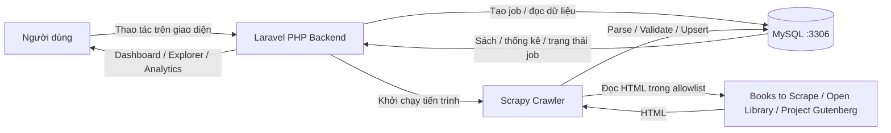

<div align="center">


# CrawlInsight

### Thu thập dữ liệu thông minh · Khám phá thông tin trực quan

**Nền tảng Web Crawling giúp biến dữ liệu phân tán trên website thành thông tin có cấu trúc, dễ tìm kiếm, theo dõi và phân tích.**

*Web Crawling & Book Data Analytics Platform*


**[Tổng quan](#-tổng-quan)** · **[Tính năng](#-tính-năng-nổi-bật)** · **[Cách hoạt động](#-cách-crawlinsight-hoạt-động)** · **[Cài đặt](#-chạy-dự-án-trên-máy-cá-nhân)** · **[Nhóm phát triển](#-nhóm-phát-triển)**

</div>

---

## 🌟 Tổng quan

Mỗi ngày, thông tin trên web được trình bày dưới nhiều cấu trúc HTML khác nhau. Nếu cần thu thập và phân tích nhiều trang, việc sao chép bằng tay vừa tốn thời gian vừa khó quản lý. **CrawlInsight** được xây dựng để thể hiện một quy trình Web Crawling có tổ chức: **truy cập nguồn được phép → phân tích HTML → chuẩn hóa → lưu trữ → tìm kiếm và trực quan hóa dữ liệu**.

Ứng dụng hiện hỗ trợ crawl sách từ ba nguồn được giới hạn sẵn: [Books to Scrape](https://books.toscrape.com/), [Open Library](https://openlibrary.org/) và [Project Gutenberg](https://www.gutenberg.org/). Đây là các nguồn phục vụ học tập, khám phá dữ liệu và sách; ứng dụng không nhận URL crawl tùy ý.

**Điểm khác biệt của dự án:** Không dừng lại ở một script lấy tiêu đề và giá sách, CrawlInsight xây dựng một **ứng dụng web đa người dùng**, nơi kết quả crawling có thể được khám phá qua giao diện hiện đại, lưu sách quan tâm, theo dõi các lượt thu thập và phân tích dữ liệu.

> [!NOTE]
> Đây là **đồ án học thuật chạy local**, chưa phải dịch vụ public/production. Crawl job truy cập website thật nên kết quả phụ thuộc kết nối Internet, cấu trúc và chính sách hiện thời của từng nguồn. Với Open Library và Project Gutenberg, giá và đánh giá là **chỉ số tham chiếu được tạo ổn định để demo/so sánh**, không phải giá bán hay điểm đánh giá thật từ các nguồn đó. Đơn vị giá hiển thị là GBP; không tự quy đổi sang VND.

## ✨ Tính năng nổi bật

| Nhóm chức năng | Trải nghiệm trong CrawlInsight |
|---|---|
| 🏠 **Trang giới thiệu** | Giới thiệu mục đích, lợi ích, cách hoạt động và hướng dẫn bắt đầu trước khi đăng ký. |
| 🔐 **Tài khoản cá nhân** | Đăng ký, đăng nhập, đăng xuất, đổi mật khẩu và đặt lại mật khẩu qua email khi SMTP được cấu hình. |
| 🕸️ **Web Crawling** | Chọn một trong ba nguồn cho phép; giới hạn mỗi lượt ở 1–3 trang danh sách, theo dõi job và lưu kết quả theo tài khoản. |
| 📊 **Dashboard** | Xem số lượng sách đã thu thập, dữ liệu tổng hợp và trạng thái lượt crawl gần đây. |
| 📚 **Khám phá sách** | Tìm kiếm, lọc theo giá/danh mục, chọn dạng lưới hoặc danh sách, xem chi tiết và lịch sử giá. |
| 🔖 **Không gian riêng** | Bookmark, bộ lọc tìm kiếm đã lưu và dữ liệu sách/crawl được giới hạn theo tài khoản. |
| 🔔 **Thông báo** | Xem thông báo trạng thái crawl và thay đổi giá của sách đã lưu; dữ liệu thông báo được cá nhân hóa theo tài khoản. |
| 🕘 **Lịch sử crawling** | Xem và xóa từng lượt crawl đã kết thúc; xóa lịch sử không xóa sách đã thu thập. |
| 📈 **Phân tích dữ liệu** | Thống kê số sách, khoảng giá, phân bố đánh giá và danh mục; xuất dữ liệu CSV. |
| 🌐 **Song ngữ** | Tiếng Việt là mặc định, hỗ trợ chuyển giao diện sang tiếng Anh. |
| 🌗 **Giao diện cá nhân hóa** | Light / Dark / System, bố cục sách và ảnh đại diện có thể tải lên, cắt, căn chỉnh trong Settings. |
| 🛡️ **Quản trị** | Admin xem danh sách tài khoản, bật/tắt tài khoản và quản lý quyền theo chính sách ứng dụng. |

### Những trang chính

| Đường dẫn | Vai trò |
|---|---|
| `/` | Trang giới thiệu công khai; đăng nhập để vào workspace |
| `/register`, `/login`, `/forgot-password` | Đăng ký, đăng nhập và yêu cầu đặt lại mật khẩu |
| `/workspace` | Trang Overview sau đăng nhập; tạo và theo dõi crawl job |
| `/books` | Khám phá sách |
| `/saved` | Sách đã lưu |
| `/history` | Lịch sử crawling |
| `/analytics` | Phân tích dữ liệu |
| `/sources` | Nguồn dữ liệu và chính sách thu thập |
| `/settings` | Hồ sơ, ảnh đại diện, giao diện, ngôn ngữ và mật khẩu |
| `/help` | Hướng dẫn sử dụng |
| `/admin/users` | Quản trị tài khoản (chỉ admin) |

## 🔄 Cách CrawlInsight hoạt động



Quy trình sử dụng điển hình:

1. **Tạo tài khoản** và đăng nhập vào workspace.
2. **Chọn nguồn dữ liệu** và giới hạn lượt crawl từ 1–3 trang danh sách.
3. **Theo dõi trạng thái** job; Laravel khởi chạy worker Scrapy riêng để phân tích trang danh sách/chi tiết và lưu MySQL.
4. **Khám phá dữ liệu** đã thu thập qua bộ lọc và trang chi tiết sách.
5. **Lưu sách yêu thích, xem thống kê hoặc xuất CSV** để phục vụ phân tích.

### Thu thập dữ liệu có trách nhiệm

Crawler chỉ truy cập HTTPS trên allowlist gồm `books.toscrape.com`, `openlibrary.org` và `gutenberg.org`; middleware kiểm tra URL kể cả khi redirect. Scrapy bật tuân thủ `robots.txt`, giới hạn một request đồng thời cho mỗi domain và đặt trễ tải một giây. Ứng dụng **không nhận URL tùy ý**, không vượt CAPTCHA hoặc né chính sách nguồn. Mỗi tài khoản chỉ có thể có một job đang chờ/chạy tại một thời điểm.

## 🧱 Công nghệ sử dụng

| Thành phần | Công nghệ | Công dụng |
|---|---|---|
| **Frontend** | HTML, CSS, JavaScript, Twig | Giao diện responsive, đa ngôn ngữ và tương tác với API |
| **Web Backend** | PHP 8.2+, Laravel 12 | Routes, session, API JSON, xử lý nghiệp vụ |
| **Crawler** | Python 3.11/3.12, Scrapy | Duyệt URL hợp lệ, request HTML, parsing, crawling pipeline |
| **Database** | MySQL/MariaDB (XAMPP, cổng 3306) | Dữ liệu runtime dùng chung giữa Laravel và worker |
| **Testing** | pytest, PHPUnit 11 | Kiểm thử crawler/parser, database, migrations và các API/tính năng PHP |
| **Môi trường phát triển** | Windows, PHP/Composer, Python venv, Git/GitHub | Chạy local và phối hợp nhóm |

MySQL/MariaDB là database runtime dùng chung giữa Laravel và crawler Python. Sách, crawl job, bookmark, bộ lọc đã lưu, thông báo, phân tích và export được truy vấn theo `user_id`; metadata nguồn/danh mục được dùng chung. Quyền admin được kiểm soát bằng `role` và middleware tại `/admin/users`. Setup có thể nhập database SQLite cũ một lần, giữ file SQLite nguồn và tạo backup khi cần nâng cấp. Schema runtime: [`database/mysql_schema.sql`](database/mysql_schema.sql); hướng dẫn: [`database/README.md`](database/README.md), [`database/DATA_DICTIONARY.md`](database/DATA_DICTIONARY.md).

Ảnh đại diện được cắt thành PNG vuông ngay trên trình duyệt, lưu ngoài public web root trong `storage/app/avatars` và chỉ được phục vụ cho tài khoản đã đăng nhập. Khi triển khai, cần thư mục lưu trữ bền vững và có quyền ghi cho PHP; có thể cấu hình `AVATAR_STORAGE_PATH` bằng đường dẫn tuyệt đối. Không cần tạo public storage symlink.

Khi chạy setup với `APP_ENV=local`, ứng dụng tự tạo sẵn hai tài khoản:

| Vai trò | Email | Mật khẩu |
|---|---|---|
| Admin | `admin@crawlinsight.local` | `CrawlInsightAdmin2026!` |
| Demo | `demo@crawlinsight.local` | `CrawlInsightDemo2026!` |

Đăng nhập tại `/login`; admin mở `/admin/users`, còn tài khoản demo có sẵn sách mẫu trong `/books`. Đây là thông tin cố định chỉ dành cho máy local, không dùng khi triển khai public. Mật khẩu trong database chỉ được lưu dạng hash. Chạy setup lại không đổi mật khẩu hoặc quyền của tài khoản đã tồn tại; nếu email mặc định đã tồn tại nhưng sai vai trò hoặc bị vô hiệu hóa, setup sẽ báo lỗi thay vì tự sửa tài khoản đó.

## 🗂️ Cấu trúc dự án

```text
LTW-TH/
├── app/                       # Laravel controllers, middleware, services, Twig renderer
├── bootstrap/                 # Khởi tạo Laravel
├── config/                    # Cấu hình ứng dụng, database, session và mail
├── resources/lang/            # Chuỗi giao diện tiếng Việt và tiếng Anh
├── routes/web.php             # Các route trang web và JSON API
├── public/                    # Laravel public entry point
├── artisan                    # Laravel CLI
├── composer.json / lock       # Dependencies PHP và PHPUnit
├── START_HERE.bat             # Cài đặt và khởi chạy local trên Windows
├── scripts/                   # Setup, start và chạy test trên Windows
├── requirements.txt           # Dependencies Python cho crawler/tests
├── .env.example               # Mẫu cấu hình local
├── templates/                 # Các trang Twig
├── static/
│   ├── css/                   # Giao diện và responsive styles
│   ├── js/                    # Tương tác giao diện và API client
│   └── img/                   # Asset giao diện
├── crawler/                   # Scrapy spiders, parser, middleware, worker
├── src/database/              # Kết nối MySQL và logic persistence cho crawler
├── database/
│   ├── mysql_schema.sql       # Schema runtime
│   ├── migrations/            # SQLite legacy migrations và avatar v8
│   ├── tools/                 # CLI kiểm tra/export/import dữ liệu
│   └── examples/              # Database demo
├── tests/php/                 # PHPUnit feature tests
├── tests/*.py                 # pytest crawler/database tests
└── docs/                      # API, cấu trúc, trạng thái và hướng dẫn kỹ thuật
```

Xem chi tiết trách nhiệm từng module: [`docs/PROJECT_STRUCTURE.md`](docs/PROJECT_STRUCTURE.md).

## 🚀 Chạy dự án trên máy cá nhân

### Yêu cầu

- **Windows 10/11**, PHP **8.2+**, Composer, Python **3.11 hoặc 3.12**, Internet để cài thư viện và crawl nguồn thử nghiệm.
- Trình duyệt hiện đại như Chrome hoặc Edge.
- XAMPP cài ở `C:\xampp` (hoặc đặt biến `XAMPP_HOME` nếu cài ở đường dẫn khác); bật extension `pdo_mysql` trong PHP.

### Cách 1: Khởi chạy nhanh trên Windows

Clone hoặc tải repository, mở thư mục dự án rồi chạy:

```bat
START_HERE.bat
```

Double-click `START_HERE.bat` hoặc chạy từ terminal tại thư mục dự án. Script dùng XAMPP MariaDB trên cổng `3306`, khởi động nếu chưa chạy, cài dependencies khi cần, tạo/cập nhật database `crawlinsight`, nhập SQLite cũ nếu tìm thấy, tạo tài khoản local mẫu và khởi chạy Laravel. Các lần sau Composer/pip được bỏ qua nếu manifest và dấu vân tay cài đặt không đổi. Nếu cổng `3306` đang do một MySQL khác sử dụng, setup dừng để tránh kết nối nhầm. Không cần mở XAMPP Control Panel trước.

Mở **http://127.0.0.1:8090/** để xem trang giới thiệu. Đăng nhập tại `/login`; sau khi đăng nhập, Overview ở **http://127.0.0.1:8090/workspace**. Logo CrawlInsight trong sidebar workspace cũng dẫn về Overview.

### Cách 2: Chạy bằng PowerShell

```powershell
# Chạy một lần sau khi clone hoặc khi cần cài/cập nhật dependencies
.\scripts\setup_windows.ps1

# Chạy ứng dụng
.\scripts\start_windows.ps1
```

Setup tạo sẵn tài khoản admin/demo cho môi trường local (thông tin đăng nhập ở trên); tài khoản demo có sách mẫu. Bạn cũng có thể đăng ký tài khoản riêng và chạy crawl từ một trong ba nguồn. Cấu hình database nằm trong `.env` (`DB_HOST=127.0.0.1`, `DB_PORT=3306`, `DB_DATABASE=crawlinsight`); PHP và worker Python dùng chung các giá trị này.

> [!IMPORTANT]
> Nếu lưu project ở `C:\xampp\htdocs\LTW-TH`, không truy cập qua Apache; hãy dùng `http://127.0.0.1:8090/`. MySQL chạy ngoài document root. Setup tạo backup SQLite trước khi nhập dữ liệu; hãy sao lưu MySQL trước khi nâng cấp.

### Kiểm thử

```powershell
.\scripts\run_tests_windows.ps1
```

Sau khi setup dependencies, script trên chạy cả pytest và PHPUnit. Có thể chạy riêng từng bộ:

```powershell
.\.venv\Scripts\python.exe -m pytest -q
composer test
```

Hai bộ test dùng SQLite tạm/độc lập để không sửa database MySQL đang dùng. Test bao phủ parser/spider ở chế độ offline, logic database/migration, API và các luồng PHP có kiểm thử; chúng không thay thế việc kiểm tra crawl live qua Internet, gửi/nhận email SMTP hoặc triển khai production. Trạng thái dự án: [`docs/03_construction/IMPLEMENTATION_STATUS_Consolidated.md`](docs/03_construction/IMPLEMENTATION_STATUS_Consolidated.md).

### Quên mật khẩu và cấu hình email

Để gửi email khôi phục mật khẩu, tạo `.env` từ `.env.example` và cấu hình SMTP riêng trên máy của bạn. Không commit `.env` hoặc mật khẩu ứng dụng lên GitHub. Khi chưa cấu hình SMTP, hệ thống sẽ thông báo email chưa sẵn sàng; chế độ hiện link đặt lại mật khẩu chỉ dành cho kiểm thử local khi bật rõ ràng trong cấu hình.

Xem hướng dẫn chi tiết: [`docs/README_TECHNICAL.md`](docs/README_TECHNICAL.md).

## 🧪 Tình trạng phát triển

| Hạng mục | Trạng thái hiện tại |
|---|---|
| Landing, xác thực, workspace, VI/EN, dark mode, hồ sơ/ảnh đại diện | **Đã triển khai**; test PHP và kiểm tra giao diện local |
| Tìm kiếm sách, bookmark, saved searches, thông báo, analytics/CSV | **Đã triển khai**; dữ liệu người dùng được phân tách theo tài khoản |
| Crawl Books to Scrape, Open Library, Project Gutenberg | **Đã có spider/parser và test offline**; crawl live phụ thuộc mạng, website và `robots.txt` |
| MySQL/MariaDB, khởi tạo schema, SQLite import | **Đã triển khai**; MySQL local được cấu hình dùng chung cho PHP và crawler |
| Gửi email đặt lại mật khẩu | **Phụ thuộc cấu hình SMTP**; cần kiểm tra bằng thông tin SMTP của môi trường |
| Triển khai production public / HTTPS | **Chưa triển khai** |

Đây là bản chạy local phục vụ đồ án. Ứng dụng hiện không hỗ trợ đăng nhập Google, URL crawl tùy ý, tự động lập lịch crawl hoặc triển khai production có sẵn.

## 📚 Tài liệu dự án

| Tài liệu | Mục đích |
|---|---|
| [API Specification](docs/02_elaboration/API_CrawlInsight_Consolidated.md) | Mô tả API Frontend–Backend |
| [Implementation Status](docs/03_construction/IMPLEMENTATION_STATUS_Consolidated.md) | Trạng thái triển khai và các hạng mục cần xác nhận |
| [Database Dictionary](database/DATA_DICTIONARY.md) | Giải thích bảng, cột và quan hệ dữ liệu |
| [Project Structure](docs/PROJECT_STRUCTURE.md) | Sơ đồ module, chức năng và file trong source |
| [Technical README](docs/README_TECHNICAL.md) | Cài đặt, cấu hình bảo mật và kiểm thử chi tiết |

## 👥 Nhóm phát triển

Dự án giữa kỳ học phần **Lập trình Web & Ứng dụng (503073)** — **Đề tài 07: Web Crawling**, Trường Đại học Tôn Đức Thắng.

| Thành viên | Chuyên ngành | Trọng tâm phối hợp |
|---|---|---|
| **Võ Trịnh Quốc Huy** | Mạng máy tính & Truyền thông dữ liệu | Điều phối, Frontend/UI/UX, tích hợp và kiểm thử |
| **Phạm Ngọc Duy** | Mạng máy tính & Truyền thông dữ liệu | Backend Laravel/PHP, API, database và bảo mật |
| **Nguyễn Trọng Quý** | Khoa học máy tính | Scrapy crawler, HTML parsing và xử lý dữ liệu |

*Phân công trên là định hướng phối hợp hiện tại; đóng góp thực tế được ghi nhận qua issue, pull request và lịch sử commit.*

## 🤝 Quy ước phát triển

- Tạo branch riêng theo chức năng và gửi pull request trước khi merge vào `main`.
- Không tự ý thay đổi API/schema; mọi thay đổi liên quan cần cập nhật SRS, API Specification và migration tương ứng.
- Khi hoàn thành task, cung cấp test case, minh chứng chạy thật (nếu có) và cập nhật Implementation Status.
- Không commit `.env`, database chứa dữ liệu người dùng, log hoặc mã thông báo khôi phục mật khẩu.

## 🌍 English summary

**CrawlInsight** is a Vietnamese-first, bilingual academic web application for crawling and analyzing book data from three allowlisted sources: Books to Scrape, Open Library, and Project Gutenberg. **Laravel/PHP** serves the pages and APIs; **Scrapy/Python** runs as a separate worker; both share **MySQL/MariaDB**. Open Library and Gutenberg price/rating fields are generated reference values, not source-provided commercial data. Windows setup can import an existing SQLite database once and creates local-only admin/demo accounts.

The application includes account-scoped books, crawl history and notifications, saved books/searches, analytics/CSV export, settings and private avatar uploads. Automated Python and PHP tests are available. Live crawling and SMTP delivery depend on the network and local configuration; production deployment is not provided.

---

<div align="center">

**CrawlInsight — From Web Pages to Meaningful Insights.**

*Built by a student team at Ton Duc Thang University · 2026*

</div>
