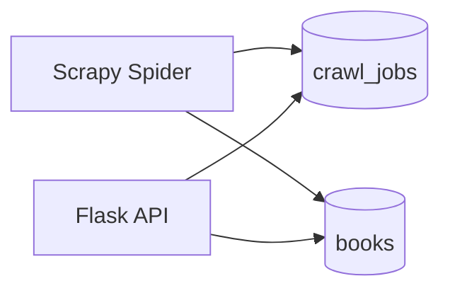
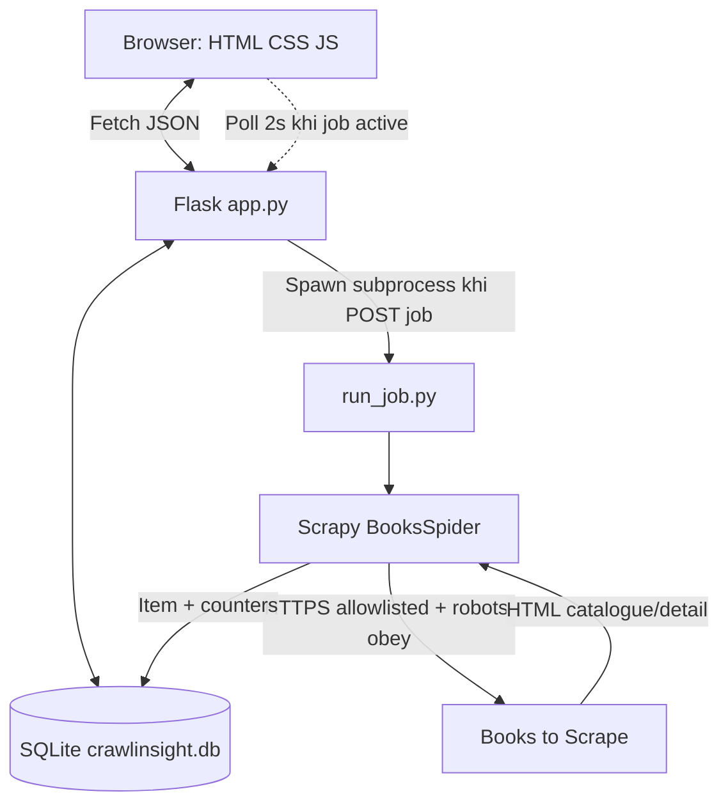

# CRAWLINSIGHT — SOFTWARE REQUIREMENTS SPECIFICATION (SRS)

**Bản đặc tả gọn để triển khai trong 10 ngày**  
**Môn học:** Lập trình Web & Ứng dụng — 503073  
**Đề tài giữa kỳ:** Topic 7 — Web Crawling  
**Tên demo:** CrawlInsight — Book Crawling & Analytics  
**Phiên bản:** 2.0 — 10-DAY IMPLEMENTATION BASELINE  
**Ngày lập:** 21/10/2026  
**Thời lượng còn lại:** 10 ngày theo thông tin của nhóm; các mốc D1–D10 là *ngày làm việc tương đối*, không tự suy ra ngày hạn nộp chính thức  
**Tình trạng:** Thiết kế đề xuất để triển khai ngay; các thành viên cần xác nhận phụ trách và cập nhật tiến độ, không coi API hay source đã tồn tại.

> **Một câu mô tả dự án:** Người dùng nhấn **Start Crawl** để thu thập dữ liệu sách từ website thử nghiệm Books to Scrape; ứng dụng cho xem tiến trình cơ bản, lưu dữ liệu vào SQLite, tìm kiếm sách và thống kê phân bố đánh giá. Đây là **demo học thuật**, không phải công cụ thu thập dữ liệu đa website.

---

## 0. ĐỌC PHẦN NÀY TRƯỚC KHI CODE

### 0.1. Phạm vi đã khóa

- **Nguồn duy nhất:** `https://books.toscrape.com/` (sandbox để học crawling).
- **Hai màn hình:** `Dashboard / Crawl` tại `/` và `Books Explorer` tại `/books`.
- **Một dạng crawl:** duyệt `1`, `2` hoặc `3` trang **danh sách** đầu tiên, đi tiếp vào trang **chi tiết** của từng sách để lấy dữ liệu. Mặc định: `1` trang.
- **Một lượt crawl tại một thời điểm**; không nhận URL tùy ý.
- **Dữ liệu bắt buộc:** tên, URL sản phẩm, giá GBP, mức sao, danh mục, tình trạng còn hàng. Ảnh và UPC là dữ liệu bổ sung nếu trích xuất được.
- **Lưu dữ liệu thật, không hard-code dữ liệu sách.** Khởi tạo mới phải có kho sách rỗng.
- **Monitoring tối thiểu:** mã job, trạng thái, số trang danh sách đã xử lý, số liên kết sách phát hiện, số sách lưu thành công, số mới/cũ, lỗi gần nhất.
- **Một biểu đồ:** số lượng sách theo mức đánh giá 1–5 sao; dữ liệu lấy từ SQLite. Ưu tiên dựng 5 thanh bằng HTML/CSS/JS thuần để không phụ thuộc CDN hay thư viện đồ thị.
- **Không có** đăng nhập, phân quyền, crawling website bất kỳ, xuất CSV, biểu đồ phức tạp, push notification, Docker, WebSocket, nhiều worker, price history hoặc tìm sản phẩm theo AI trong bản 10 ngày.

### 0.2. Nguyên tắc không được vi phạm

1. Không làm giao diện trước rồi dùng JSON giả như kết quả cuối. Dùng fixture để test được, nhưng phải phân biệt với dữ liệu live.
2. Không cho phép truyền URL bất kỳ từ trình duyệt vào spider. Backend tự dùng URL nguồn cố định.
3. Không coi **số trang danh sách** là **số request HTTP**; mỗi sách còn cần request tới trang chi tiết.
4. Không gọi là cập nhật “real-time” bằng WebSocket: trình duyệt chỉ **poll API 2 giây/lần** khi job chưa kết thúc.
5. Không hứa luôn lấy chính xác 20 sách/trang: nguồn hiện hiển thị 20, nhưng số liệu nghiệm thu phải dựa trên phản hồi thật và có xử lý lỗi.
6. Không chạy setup phá hủy XAMPP, `htdocs` hoặc database của đồ án khác. Dự án mới chạy độc lập bằng Python, không cần XAMPP.
7. Không phát triển tính năng tùy chọn trước khi toàn bộ yêu cầu `MUST` và test nghiệm thu chính qua được.

### 0.3. Thứ tự ưu tiên

- **MUST:** bắt buộc cho bản nộp 10 ngày.
- **SHOULD:** làm khi toàn bộ MUST đã ổn định (ví dụ cải thiện giao diện).
- **OUT:** không làm trong 10 ngày; chỉ nêu ở Future Work của báo cáo.

---

# 1. CĂN CỨ VÀ MỤC TIÊU

## 1.1. Những điều **đề giữa kỳ thực sự yêu cầu**

Theo `503073-Midterm-V1.docx`, Topic 7 — Web Crawling yêu cầu nghiên cứu cách hoạt động của crawling, HTML parsing, `robots.txt`, các khía cạnh đạo đức/pháp lý và ứng dụng trong tổng hợp nội dung, SEO, nghiên cứu. Đề **gợi ý**, không bắt buộc chính xác một mẫu demo: xây crawler thu thập nội dung website; lọc và lưu một số trường cụ thể. Giảng viên cho phép chọn công nghệ phù hợp, nhưng demo không nên quá đơn giản.

Ngoài demo, đề còn yêu cầu: báo cáo **Word và PDF** theo template khoa, **20–60 trang** không tính bìa/phụ lục; mã nguồn đầy đủ, dependencies và README setup; video thuyết trình tối đa **20 phút** có nội dung lý thuyết, kiến trúc, thực hành; các thành viên cùng tham gia. Đề cũng lưu ý báo cáo và video nên bằng **tiếng Anh** để tránh bị trừ điểm. Thang chấm: **6 điểm báo cáo và 4 điểm demo**.

**Phân biệt nguồn:** Những nội dung trên là yêu cầu học phần. Mọi giới hạn 1–3 trang, tên endpoint, bảng DB, công nghệ và tiêu chí kiểm thử dưới đây là **quyết định thiết kế của nhóm**, không phải quy định của giảng viên.

## 1.2. Vấn đề cần giải quyết

Thông tin sách trên web là HTML dành cho người đọc, chưa thuận tiện để tra cứu và phân tích hàng loạt. CrawlInsight minh họa luồng biến **nhiều trang HTML liên kết với nhau** thành **dữ liệu có cấu trúc**. Giá trị kỹ thuật chính nằm ở khả năng **tìm liên kết → truy cập nhiều trang → phân tích HTML → chuẩn hóa → chống trùng → lưu lại**; giao diện chỉ giúp quan sát và kiểm chứng chu trình đó.

## 1.3. Mục tiêu có thể đo và kiểm thử

- **G-01:** Nhấn Start Crawl từ UI tạo được một lần thu thập thực sự, không dùng dữ liệu mẫu trá hình.
- **G-02:** Spider xử lý được ít nhất hai trang danh sách liên tiếp và đi vào trang chi tiết của sách khi lựa chọn `max_pages=2` và nguồn hoạt động.
- **G-03:** Tối thiểu sáu trường cốt lõi của một sách được trích xuất, chuẩn hóa, lưu và hiển thị chính xác.
- **G-04:** Crawl lại cùng phạm vi không làm tăng số lượng sách vì trùng URL.
- **G-05:** Có bằng chứng kỹ thuật cho `robots.txt`, giới hạn tốc độ, crawling logic, HTML parser và thao tác đọc/ghi DB.
- **G-06:** Người chấm có thể làm theo README, khởi chạy web và kiểm thử luồng chính trên máy Windows thông thường.
- **G-07:** Hoàn thành báo cáo và video trong 10 ngày, ưu tiên ổn định hơn số lượng tính năng.

## 1.4. Phân tích khả thi và quyết định kỹ thuật

| Tiêu chí | SRS cũ (8 tuần) | Bản mới (10 ngày) | Lý do |
|---|---|---|---|
| Công nghệ | PHP + MySQL + Python Scrapy | **Python Flask + Scrapy + SQLite** | Một ngôn ngữ cho web/backend/crawler, ít thành phần và cấu hình hơn |
| CSDL | 8 bảng, quan hệ job/log/worker phức tạp | **2 bảng `books`, `crawl_jobs`** | Đủ chứng minh lưu dữ liệu, chống trùng và trạng thái |
| UI | Nhiều màn hình riêng | **2 màn hình** | Giảm thời gian tích hợp và QA |
| Jobs | Queue, worker heartbeat, recovery sâu | **Một subprocess crawler mỗi lần crawl; chặn chạy đồng thời** | Đơn giản hơn nhưng vẫn có giám sát |
| Analytics | Nhiều chart, CSV, history nâng cao | **1 chart rating và lịch sử 5 job** | Đủ biểu diễn kết quả crawling |
| Dữ liệu | Có thể hướng tới 1.000 sách | **1–3 catalogue pages mỗi job** | Giữ demo ngắn, ít tác động server nguồn |

**Quyết định D-01 (baseline):** Dùng Flask + SQLite + Scrapy. Flask có thể làm API/backend tối giản, Scrapy làm crawling và HTML parsing, SQLite lưu database trong một file. Đây là thay đổi có chủ đích so với `ideas.md`/SRS cũ do hạn còn 10 ngày. Team phải cập nhật `ideas.md` nếu dùng tài liệu đó như bản định hướng chính thức. Nếu đã có source PHP hoạt động tốt thì cần lập một Change Request trước khi đổi lại stack; **không làm đồng thời hai kiến trúc**.

**Đánh giá rủi ro thực tế:** Có khả năng hoàn thành trong 10 ngày với nhóm 3 người và biết Python/HTML/JS cơ bản nếu chốt phạm vi tại đây. Không thể bảo đảm hoàn thành tuyệt đối vì còn phụ thuộc năng lực nhóm, thời gian rảnh, Internet, site nguồn và tốc độ tích hợp.

---

# 2. PHẠM VI SẢN PHẨM VÀ VAI TRÒ

## 2.1. Người sử dụng

**Operator (người vận hành demo):** Sinh viên hoặc giảng viên chạy ứng dụng cục bộ, chọn số trang muốn crawl, theo dõi, xem sách và biểu đồ. **Không yêu cầu tài khoản**. Một máy chạy ứng dụng, không thiết kế cho nhiều người truy cập đồng thời từ Internet.

## 2.2. Use cases đã chốt

| ID | Use case | Đầu vào | Kết quả mong muốn |
|---|---|---|---|
| UC-01 | Bắt đầu crawl | Chọn `max_pages` (1–3) | Tạo job, tiến trình Python bắt đầu xử lý |
| UC-02 | Theo dõi một job | Job ID | Tiến độ và trạng thái lấy từ DB/API |
| UC-03 | Duyệt sách | Mở Books | Danh sách dữ liệu đã thu thập, có phân trang |
| UC-04 | Tìm/lọc sách | Từ khóa tên, khoảng giá | Danh sách chính xác theo điều kiện |
| UC-05 | Xem thống kê | Mở Dashboard | Số sách tổng và biểu đồ rating từ DB |
| UC-06 | Kiểm tra chống trùng | Crawl lại phạm vi cũ | Không sinh bản ghi sách trùng |

## 2.3. Nội dung loại bỏ hoàn toàn khỏi 10 ngày

- Tự điền một URL bất kỳ; crawl Shopee, Tiki, Amazon hay trang thật có điều khoản hạn chế; tự tạo spider nhiều nguồn.
- Crawl ảnh nhị phân, lưu ảnh local, ảnh AI, gợi ý sách, đăng nhập, phân quyền, thông báo email.
- Tạm dừng/tiếp tục/hủy job; tự lên lịch crawl; crawl 1000 sách một lần từ giao diện.
- So sánh biến động giá theo ngày, lịch sử phiên bản sách, biểu đồ network graph, dashboard kỹ thuật nhiều trang.
- CSV/Excel/PDF export; phân trang vô hạn; dynamic content bằng Playwright/Selenium; Docker/deploy production.
- Đảm bảo phục hồi process bị hệ điều hành kill. Đây là **giới hạn được công khai** ở phần rủi ro, không đánh đồng với sản phẩm production.

---

# 3. HÀNH VI SẢN PHẨM: BA LUỒNG CHÍNH

## 3.1. Luồng A — Khởi động lần đầu

1. Người dùng chạy `python app.py` sau khi setup và khởi tạo DB.
2. Mở `http://127.0.0.1:5000/`.
3. Dashboard hiển thị `Total books: 0`, `No crawl yet` và nút **Start Crawl**. Biểu đồ hiển thị empty state, không tạo 5 cột giả.
4. Người dùng chọn `1`, `2` hoặc `3` trang danh sách (mặc định 1), nhấn Start Crawl.
5. Backend từ chối nếu đang có job `PENDING` hoặc `RUNNING`; ngược lại tạo record job và khởi động subprocess crawler.
6. UI hiển thị job mới; polling `GET /api/jobs/{id}` mỗi 2 giây cho tới khi `COMPLETED` hoặc `FAILED`.
7. Sau khi kết thúc, KPI và Books cập nhật theo dữ liệu đã thực sự lưu. Nếu người dùng **reload Dashboard khi job còn active**, frontend đọc `last_job.id` từ `/api/summary` rồi tiếp tục polling `/api/jobs/{id}`; không khởi tạo job mới.

## 3.2. Luồng B — Crawler lấy dữ liệu

1. Subprocess nhận `job_id`; xác nhận `PENDING` rồi chuyển `RUNNING`.
2. Spider bắt đầu từ `https://books.toscrape.com/`, kiểm tra chính sách robots và chỉ request host cho phép.
3. Phân tích một trang danh sách: chọn các URL sách, chuẩn hóa URL, bỏ URL trùng trong cùng job, đưa chúng vào lịch tải chi tiết.
4. Nếu chưa đạt `max_pages`, tìm liên kết **Next** hợp lệ và tiếp tục trang danh sách kế tiếp (không được đoán tất cả URL rồi gọi là crawling).
5. Trang chi tiết trả dữ liệu: `title`, `source_url`, `price_pence`, `rating`, `category`, `availability`; có thể thêm `image_url`, `upc`.
6. Từng item hợp lệ được **upsert** vào SQLite theo `source_url` duy nhất; không có sách giả nếu parser không tìm được dữ liệu.
7. Cập nhật bộ đếm job sau khi DB ghi thành công.
8. Job kết thúc `COMPLETED` nếu có ít nhất một item lưu thành công và không có lỗi nghiêm trọng ngăn việc chạy; nếu không xử lý được item nào, kết thúc `FAILED` và ghi lý do.

**Lưu ý:** Một job có lỗi lẻ tẻ nhưng vẫn lưu được sách có thể là `COMPLETED` với `error_count > 0`; UI hiển thị **Completed with warnings**, không lập thêm trạng thái thứ năm.

## 3.3. Luồng C — Khám phá dữ liệu

1. Mở `/books`: hiển thị danh sách từ SQLite theo `id DESC`, 12 sách/trang.
2. Tìm bằng **một từ khóa trong tên sách**, không cần full-text engine.
3. Có thể lọc theo khoảng giá GBP; mọi lọc do API và SQL thực thi.
4. Xem ảnh (nếu có), tên, giá `£xx.xx`, rating, category, availability và liên kết tới trang sách nguồn.
5. Dashboard có biểu đồ rating 1–5 sao tính trên **toàn bộ kho sách lưu được**, không bị thay đổi theo bộ lọc của Books trong MVP.

---

# 4. YÊU CẦU CHỨC NĂNG (FUNCTIONAL REQUIREMENTS)

> Mỗi `FR` dưới đây là **MUST**, trừ khi có nhãn `SHOULD`. Một FR đạt khi hành vi đúng và test tương ứng PASS; “đã code” nhưng chưa test thì chưa hoàn thành.

## 4.1. Nhóm UI / Dashboard

| Mã | Yêu cầu có thể kiểm tra | Khi nào đạt |
|---|---|---|
| **FR-01** | Dashboard lấy tổng số sách và thống kê job từ API | DB rỗng hiện 0; DB có sách hiện số đúng, không dùng fixtures trên production UI |
| **FR-02** | Hiển thị form chọn `max_pages` là 1, 2, 3; mặc định 1 | Nhập ngoài tập hợp bị frontend chặn và backend từ chối |
| **FR-03** | Nhấn Start Crawl tạo job và cập nhật trạng thái ngay | Hiện mã job mới hoặc lỗi rõ ràng, không reload vô cớ |
| **FR-04** | Khi job chạy, UI poll 2 giây/lần | Hiện `PENDING/RUNNING/COMPLETED/FAILED` và bộ đếm thật; dừng poll khi kết thúc |
| **FR-05** | Hiện 5 job gần đây trên Dashboard | Sắp xếp mới nhất trước; ít hơn 5 thì hiển thị số hiện có |
| **FR-06** | Dashboard vẽ 1 biểu đồ phân bố rating 1–5 | Tổng năm cột bằng số sách có rating hợp lệ trong DB; DB rỗng có empty state |

## 4.2. Nhóm Crawling & bảo vệ nguồn

| Mã | Yêu cầu có thể kiểm tra | Khi nào đạt |
|---|---|---|
| **FR-07** | Chỉ crawl host `books.toscrape.com` qua HTTPS | Không có giao diện URL tự do; URL ngoài host không được phát request |
| **FR-08** | Spider duyệt `max_pages` trang danh sách đầu, đi theo liên kết Next | Với 2 trang, log/đếm cho thấy đã xử lý các trang 1 và 2; không vượt 2 |
| **FR-09** | Spider tải chi tiết các sách tìm thấy | Có trường dữ liệu từ detail page như category/UPC, không chỉ copy card danh sách |
| **FR-10** | HTML được parse bằng selector rõ ràng, validate trường cốt lõi | Với HTML fixture hợp lệ cho ra expected item; lỗi thiếu title/price không ghi record giả |
| **FR-11** | Cấu hình `ROBOTSTXT_OBEY=True`, giới hạn 1 concurrent request/domain, delay mặc định 1 giây | Settings và runtime check khớp; không cố vượt trang bị chặn |
| **FR-12** | Crawler xử lý timeout, HTTP lỗi hoặc HTML đổi cấu trúc mà không làm hỏng DB | Có ghi `error_count`/`last_error`; item lỗi không tạo record sách không hợp lệ |

## 4.3. Nhóm Data & Job Processing

| Mã | Yêu cầu có thể kiểm tra | Khi nào đạt |
|---|---|---|
| **FR-13** | Backend tạo và cập nhật job với 4 trạng thái cố định | `PENDING → RUNNING → COMPLETED/FAILED`, timestamps hợp lệ |
| **FR-14** | Cùng lúc chỉ cho phép 1 job `PENDING/RUNNING` | Request thứ hai nhận `409 JOB_ALREADY_ACTIVE`, không mở crawler thứ hai |
| **FR-15** | `books.source_url` có UNIQUE; mỗi item hợp lệ được upsert | Crawl lại dữ liệu cũ không tạo record trùng |
| **FR-16** | Bộ đếm job đúng ngữ nghĩa | `items_saved = new_books + existing_books`; counter không sử dụng tổng sách DB |
| **FR-17** | Backend cung cấp API JSON với status code/mã lỗi nhất quán | Frontend xử lý được 400/404/409/500 và loading/empty/error |

## 4.4. Nhóm Books Explorer

| Mã | Yêu cầu có thể kiểm tra | Khi nào đạt |
|---|---|---|
| **FR-18** | Books API trả sách 12 item/trang, mới nhất trước | `page=1`/`page=2` khác nhau, `total` và `total_pages` chính xác |
| **FR-19** | Tìm kiếm không phân biệt hoa/thường theo tên sách | Từ khóa và chuỗi trống đều hoạt động; tìm không ra cho mảng rỗng |
| **FR-20** | Bộ lọc giá cho `min_price`/`max_price` theo GBP (0–9999.99) | Giá hiển thị khớp; giá min > max trả 400; dữ liệu dùng số pence trong DB |
| **FR-21** | Một thẻ sách có tên, giá, sao, danh mục, availability và URL nguồn | HTML escape an toàn; link nguồn mở tab mới với `rel="noopener noreferrer"` |

## 4.5. Yêu cầu SHOULD (không ảnh hưởng điều kiện hoàn thành MVP)

| Mã | Yêu cầu | Chỉ làm nếu |
|---|---|---|
| **FR-S1** | Giao diện responsive được tinh chỉnh đẹp ở màn hình nhỏ | Tất cả FR-01..21 đã PASS |
| **FR-S2** | Hiển thị thumbnail từ URL nguồn và placeholder khi ảnh lỗi | Không cần tải ảnh về server, không chậm luồng crawling |
| **FR-S3** | Bộ lọc danh mục ở Books Explorer | Có sẵn thời gian cho QA và báo cáo |

---

# 5. QUY TẮC NGHIỆP VỤ, ĐỊNH NGHĨA SỐ ĐẾM

| Mã | Quy tắc thống nhất |
|---|---|
| **BR-01** | `max_pages` chỉ nhận integer 1–3, chọn trong UI; backend không chấp nhận chuỗi/float, Boolean hoặc giá trị ngoài khoảng. |
| **BR-02** | `source_url` là URL tuyệt đối HTTPS, hostname phải là `books.toscrape.com`, bỏ fragment trước khi lưu. Không crawl link ngoài host. |
| **BR-03** | Mỗi URL sản phẩm chỉ được lưu **một lần trong mỗi job**; nếu tìm từ hai đường dẫn catalogue thì bỏ trùng trong job. |
| **BR-04** | Giá lưu bằng **integer pence**; ví dụ `£12.34` → `1234`; không dùng float để so sánh trực tiếp tiền. |
| **BR-05** | `rating` là số nguyên 1..5. Nếu trang thiếu hoặc không thể đọc trường cốt lõi thì item không hợp lệ. |
| **BR-06** | `catalogue_pages_done`: số trang danh sách đã tải và parse hợp lệ, không bao gồm trang chi tiết. |
| **BR-07** | `books_found`: số URL chi tiết sách duy nhất đã lên lịch trong job, không phải số sách đã ghi thành công. |
| **BR-08** | `items_saved`: số item hợp lệ đã được ghi DB thành công trong job (mỗi URL tối đa một lần); `new_books`: URL trước đó chưa có; `existing_books`: URL đã có. |
| **BR-09** | `new_books + existing_books = items_saved`, và `items_saved <= books_found` (với tất cả URL chỉ được xử lý một lần). |
| **BR-10** | Khi crawl sách cũ, cập nhật thông tin và `last_seen_at`; `first_seen_at` không đổi. Phân loại `existing_books` kể cả dữ liệu không thay đổi. |
| **BR-11** | Không xóa dữ liệu sách cũ khi một job lỗi; job mới lỗi không làm mất dataset trước đó. |
| **BR-12** | Kết quả rating thống kê trên bảng books; cộng năm mức 1..5. Giá nguồn là GBP và không có giá trị giao dịch thực tế (sandbox). |
| **BR-13** | Mọi timestamp trong DB/API là UTC ISO 8601 dạng `YYYY-MM-DDTHH:MM:SSZ`. |
| **BR-14** | Job chuyển `COMPLETED` với `items_saved >= 1`; lỗi đơn lẻ được tính trong `error_count`. Nếu không lưu được item nào hoặc subprocess thất bại nghiêm trọng, dùng `FAILED`. |
| **BR-15** | Frontend tuyệt đối không tự biến `PENDING/RUNNING` thành `COMPLETED` khi hết timeout poll; dữ liệu trạng thái chỉ từ API. |

### 5.1. Công thức hiển thị

- **Total Books** = `SELECT COUNT(*) FROM books`.
- **Last Crawl** = bản ghi `crawl_jobs` mới nhất theo `id DESC`, dù thất bại hay hoàn thành, nhưng hiển thị đúng status.
- **Rating Distribution** = số sách theo `rating` 1..5 trên toàn DB.
- **Job Progress** = chuỗi số đếm và trạng thái, **không đưa ra phần trăm giả**. Vì crawler chưa biết chắc tổng số URL hoàn chỉnh trước khi chạy nên không có progress bar `%` trong MVP.
- **New vs Existing** = phân loại đối với dataset **trước khi ghi item hiện tại**, không dựa vào khác biệt từng trường.

### 5.2. Các tình huống thất bại phải có hành vi rõ ràng

| Tình huống | Kết quả bắt buộc |
|---|---|
| Website nguồn không phản hồi | Job FAILED nếu không lưu được sách nào; UI có thông báo và hướng xem lý do |
| HTML thay đổi selector | Bỏ item không hợp lệ, tăng lỗi, không lưu sách rỗng hoặc `£0` giả |
| User nhấn Start lần thứ hai khi đang chạy | HTTP 409, giữ job cũ và hiển thị thông báo |
| Người dùng đóng tab | Crawler subprocess vẫn có thể tiếp tục (trong lúc máy/process còn chạy); mở lại trang xem trạng thái DB |
| Người dùng dừng/kết thúc Python process bất thường | Có thể còn trạng thái RUNNING; không hứa tự recovery trong MVP, README mô tả thao tác reset trạng thái demo khi chắc chắn worker đã dừng |
| DB khóa tạm thời | SQLite retry theo busy timeout; nếu sau giới hạn vẫn thất bại thì log và dừng/đánh lỗi thay vì ghi dữ liệu sai |
| Không có sách trong DB | Dashboard và Books hiển thị empty state với nút bắt đầu crawl |
| Filter không tìm thấy kết quả | Trả `items: []` và `total: 0`, không báo lỗi hệ thống |

---

# 6. ĐẶC TẢ MÀN HÌNH — UI MÀ TEAM CẦN CODE

## 6.1. Màn hình `GET /` — Dashboard + Crawl Monitor

```text
┌─────────────────────────────────────────────────────────────┐
│ CrawlInsight                         Dashboard  |  Books   │
├─────────────────────────────────────────────────────────────┤
│ BOOKS TO SCRAPE  (Source cố định, không nhập URL)           │
│ Total Books: 0 / ...    Last Crawl: No crawl / <status>     │
│                                                             │
│ New Crawl: [1 page v]  [ START CRAWL ]                       │
│                                                             │
│ Current Job #12 — RUNNING                                   │
│ Catalogue: 1 | Found: 20 | Saved: 13 | New: 13 | Existing: 0│
│ Error: None                                                 │
│                                                             │
│ Rating Distribution (1..5 stars)                            │
│ [chart/empty state]                                         │
│                                                             │
│ Recent jobs (max 5)                                         │
│ Job  Status  Pages  Saved  Started  Finished                │
└─────────────────────────────────────────────────────────────┘
```

**Trạng thái giao diện phải có:**

- `Initial loading`: hiện skeleton hoặc câu “Loading...”; không render số 0 trước khi API trả về rồi coi là dữ liệu thật.
- `Empty`: “No books yet. Start your first crawl.”; form luôn khả dụng nếu không có job hoạt động.
- `PENDING`: “Crawl queued”.
- `RUNNING`: “Crawling...”; nút Start bị vô hiệu, chỉ hiển thị counters (không dựng tỷ lệ %).
- `COMPLETED`: “Crawl completed” hoặc “Completed with warnings” khi `error_count > 0`.
- `FAILED`: “Crawl failed” và `last_error` an toàn; nút Start cho phép thử lại.
- `API error`: báo lỗi và nút Retry; không để giao diện trắng.

## 6.2. Màn hình `GET /books` — Book Explorer

```text
┌─────────────────────────────────────────────────────────────┐
│ CrawlInsight                        Dashboard | Books       │
├─────────────────────────────────────────────────────────────┤
│ Search title [_________________] [Search]                  │
│ Price (GBP): From [____] To [____]  [Apply] [Reset]          │
│ Results: 26 books                                           │
│ ┌─────────────┐ ┌─────────────┐ ┌─────────────┐             │
│ │ thumbnail   │ │ thumbnail   │ │ thumbnail   │             │
│ │ Title       │ │ Title       │ │ Title       │             │
│ │ £12.34 ★★★★ │ │ £...        │ │ £...        │             │
│ │ Category    │ │ Category    │ │ Category    │             │
│ │ Open source │ │ Open source │ │ Open source │             │
│ └─────────────┘ └─────────────┘ └─────────────┘             │
│ Previous  1 / 3  Next                                       │
└─────────────────────────────────────────────────────────────┘
```

**Đặc tả hành vi:** tìm kiếm và lọc kết hợp bằng phép AND; nhấn Apply đặt lại page=1; Next/Previous chỉ hiện/hoạt động khi còn trang; nút Reset xóa query. Khi từ khóa trống thì không lọc theo tên. Form không tự submit liên tục mỗi ký tự — tránh gọi API quá nhiều.

**Không làm trong MVP:** trang Book Detail riêng; modal chỉnh sửa; user reviews, cart, favorite; biểu đồ trên Books.

---

# 7. DATABASE CONTRACT — CHỈ HAI BẢNG

## 7.1. Sơ đồ quan hệ đơn giản



Giữa `crawl_jobs` và `books` **không có khóa ngoại** trong phiên bản 10 ngày. Ta chỉ cần đếm mới/cũ theo job, không cần lịch sử sách theo từng lượt crawl.

## 7.2. `books` — hợp đồng dữ liệu

| Field | Kiểu SQLite | Bắt buộc | Ý nghĩa |
|---|---|---|---|
| `id` | INTEGER PK | Có | Mã bản ghi nội bộ |
| `source_url` | TEXT UNIQUE NOT NULL | Có | Định danh sách đã chuẩn hóa |
| `title` | TEXT NOT NULL | Có | Tên đầy đủ từ trang detail |
| `price_pence` | INTEGER NOT NULL | Có | Giá GBP ở đơn vị penny, >=0 |
| `rating` | INTEGER NOT NULL | Có | Rating 1..5 |
| `category` | TEXT NOT NULL | Có | Danh mục lấy từ breadcrumb |
| `availability` | TEXT NOT NULL | Có | `In stock`, `Out of stock` hoặc raw normalized |
| `image_url` | TEXT | Không | URL ảnh nếu có, không tải ảnh về DB |
| `upc` | TEXT | Không | Mã sản phẩm từ bảng thông tin |
| `first_seen_at` | TEXT NOT NULL | Có | Lần đầu thêm sách, UTC |
| `last_seen_at` | TEXT NOT NULL | Có | Lần gần nhất crawl thành công, UTC |

## 7.3. `crawl_jobs` — hợp đồng dữ liệu

| Field | Kiểu SQLite | Mặc định | Ý nghĩa |
|---|---|---|---|
| `id` | INTEGER PK | auto | ID job |
| `max_pages` | INTEGER | Không có | Số trang catalogue được phép duyệt, 1..3 |
| `status` | TEXT | `PENDING` | Một trong PENDING/RUNNING/COMPLETED/FAILED |
| `catalogue_pages_done` | INTEGER | 0 | Catalogue pages đã xử lý |
| `books_found` | INTEGER | 0 | URL sách chi tiết duy nhất đã phát hiện |
| `items_saved` | INTEGER | 0 | Item DB upsert thành công |
| `new_books` | INTEGER | 0 | Item chưa có trước thời điểm upsert |
| `existing_books` | INTEGER | 0 | Item đã có trước thời điểm upsert |
| `error_count` | INTEGER | 0 | Số lỗi crawler/parse/DB được ghi nhận |
| `last_error` | TEXT | NULL | Mô tả lỗi gần nhất đã rút gọn |
| `created_at` | TEXT | UTC now | Tạo job |
| `started_at` | TEXT | NULL | Bắt đầu xử lý |
| `finished_at` | TEXT | NULL | Job kết thúc |

## 7.4. Schema SQL baseline (có thể chép vào `database/schema.sql`)

```sql
PRAGMA foreign_keys = ON;
PRAGMA journal_mode = WAL;
PRAGMA busy_timeout = 5000;

CREATE TABLE IF NOT EXISTS books (
    id INTEGER PRIMARY KEY AUTOINCREMENT,
    source_url TEXT NOT NULL UNIQUE,
    title TEXT NOT NULL,
    price_pence INTEGER NOT NULL CHECK (price_pence >= 0),
    rating INTEGER NOT NULL CHECK (rating BETWEEN 1 AND 5),
    category TEXT NOT NULL,
    availability TEXT NOT NULL,
    image_url TEXT,
    upc TEXT,
    first_seen_at TEXT NOT NULL,
    last_seen_at TEXT NOT NULL
);

CREATE TABLE IF NOT EXISTS crawl_jobs (
    id INTEGER PRIMARY KEY AUTOINCREMENT,
    max_pages INTEGER NOT NULL CHECK (max_pages BETWEEN 1 AND 3),
    status TEXT NOT NULL DEFAULT 'PENDING'
        CHECK (status IN ('PENDING','RUNNING','COMPLETED','FAILED')),
    catalogue_pages_done INTEGER NOT NULL DEFAULT 0,
    books_found INTEGER NOT NULL DEFAULT 0,
    items_saved INTEGER NOT NULL DEFAULT 0,
    new_books INTEGER NOT NULL DEFAULT 0,
    existing_books INTEGER NOT NULL DEFAULT 0,
    error_count INTEGER NOT NULL DEFAULT 0,
    last_error TEXT,
    created_at TEXT NOT NULL,
    started_at TEXT,
    finished_at TEXT,
    CHECK (items_saved = new_books + existing_books),
    CHECK (catalogue_pages_done >= 0),
    CHECK (books_found >= 0),
    CHECK (items_saved >= 0)
);

CREATE INDEX IF NOT EXISTS idx_books_title ON books(title);
CREATE INDEX IF NOT EXISTS idx_books_price ON books(price_pence);
CREATE INDEX IF NOT EXISTS idx_jobs_created ON crawl_jobs(id DESC);
```

**Quy tắc triển khai:** Hạn chế ghi SQLite từ nhiều thành phần cùng lúc bằng WAL và `busy_timeout`. Việc upsert sách và cập nhật counter của job phải nằm trong **một transaction**, nên nếu transaction lỗi không xuất hiện counter tăng nhưng sách chưa ghi.

Ví dụ upsert: tìm record theo `source_url`; nếu chưa tồn tại thì INSERT + new_books++; nếu đã tồn tại thì UPDATE + existing_books++. Dùng transaction và unique index. **Không** dùng `INSERT OR REPLACE` vì có thể thay đổi id và first_seen_at.

## 7.5. Contract item của crawler

```json
{
  "source_url": "https://books.toscrape.com/catalogue/example_123/index.html",
  "title": "Example Book Title",
  "price_pence": 1234,
  "rating": 4,
  "category": "Travel",
  "availability": "In stock",
  "image_url": "https://books.toscrape.com/media/cache/example.jpg",
  "upc": "example-upc"
}
```

**Lưu ý:** JSON trên minh họa schema, **không** đại diện cho một sách có thật, và không đưa vào production DB như dữ liệu thật.

---

# 8. API CONTRACT — FRONTEND PHẢI LẬP TRÌNH THEO ĐÚNG MẪU

## 8.1. Quy ước chung

- Flask cùng origin với frontend; API prefix: `/api`.
- `Content-Type: application/json; charset=utf-8` cho JSON.
- Response thành công có đúng các field mô tả trong từng endpoint; không tự đổi `items_saved` sang `saved_count` khi code.
- Response lỗi nhất quán:

```json
{
  "error": {
    "code": "INVALID_MAX_PAGES",
    "message": "max_pages must be an integer from 1 to 3"
  }
}
```

- HTTP: 200 GET OK; 202 tạo job; 400 đầu vào sai; 404 không tìm thấy job/page không tồn tại; 409 xung đột job; 500 lỗi server; 503 không khởi động được crawler.
- Giá cho `GET /api/books` được trả `price_pence`; frontend chuyển sang hiển thị `£xx.xx`, không làm tròn float từ DB.
- UI không coi body báo lỗi 500 là mảng sách; luôn kiểm tra `response.ok`.

## 8.2. `GET /api/summary`

Response `200`:

```json
{
  "total_books": 42,
  "completed_jobs": 2,
  "last_job": {
    "id": 3,
    "status": "COMPLETED",
    "created_at": "2026-10-21T10:00:00Z"
  },
  "rating_distribution": [
    {"rating": 1, "count": 5},
    {"rating": 2, "count": 7},
    {"rating": 3, "count": 10},
    {"rating": 4, "count": 12},
    {"rating": 5, "count": 8}
  ],
  "recent_jobs": [
    {"id": 3, "status": "COMPLETED", "max_pages": 2, "items_saved": 42, "created_at": "2026-10-21T10:00:00Z"}
  ]
}
```

**Chú ý:** Dữ liệu ở đây là **ví dụ response**, không phải kết quả crawl đã có. Nếu database rỗng: `total_books=0`, `completed_jobs=0`, `last_job=null`, `rating_distribution` gồm 5 bucket có `count=0`, `recent_jobs=[]`.

## 8.3. `POST /api/jobs`

Request:

```json
{"max_pages": 1}
```

`202 Accepted`:

```json
{
  "job": {
    "id": 4,
    "status": "PENDING",
    "max_pages": 1,
    "created_at": "2026-10-21T10:05:00Z"
  }
}
```

Validation: body phải là JSON object có **chính xác một** field `max_pages`; nhận integer 1/2/3, từ chối float, string, bool, thiếu key hoặc key lạ. **Trong Python phải dùng `type(value) is int`**, vì `isinstance(True, int)` trả `True`. Job đang active trả `409` + `JOB_ALREADY_ACTIVE`. Backend **tạo job rồi launch process Python** bằng đường dẫn có sẵn trong code/config, tuyệt đối không nối lệnh shell từ chuỗi do người dùng nhập. Nếu launch thất bại: đánh job `FAILED`, trả `503 CRAWLER_LAUNCH_FAILED` (nếu id đã tạo thì có thể kèm `job_id` để debug).

## 8.4. `GET /api/jobs/{id}`

`200 OK`:

```json
{
  "job": {
    "id": 4,
    "max_pages": 1,
    "status": "RUNNING",
    "catalogue_pages_done": 1,
    "books_found": 20,
    "items_saved": 7,
    "new_books": 7,
    "existing_books": 0,
    "error_count": 0,
    "last_error": null,
    "created_at": "2026-10-21T10:05:00Z",
    "started_at": "2026-10-21T10:05:01Z",
    "finished_at": null
  }
}
```

404 khi `id` không tồn tại. `PENDING`/`RUNNING` thì UI tiếp tục polling; với `COMPLETED`/`FAILED` thì dừng polling và refresh `/api/summary` cùng `/api/books` nếu đang ở trang đó.

## 8.5. `GET /api/books`

Query parameters:

| Param | Default | Quy tắc |
|---|---|---|
| `q` | chuỗi trống | substring tên sách, tối đa 100 ký tự; so khớp case-insensitive |
| `min_price` | rỗng | số decimal GBP với tối đa 2 chữ số sau dấu chấm, trong [0, 9999.99] |
| `max_price` | rỗng | tương tự; bắt buộc min <= max nếu cả hai có mặt |
| `page` | 1 | integer >=1, tối đa 100000; giá trị quá giới hạn trả 400 |

Response `200`:

```json
{
  "items": [
    {
      "id": 9,
      "title": "Example Book Title",
      "price_pence": 1234,
      "rating": 4,
      "category": "Travel",
      "availability": "In stock",
      "image_url": null,
      "source_url": "https://books.toscrape.com/catalogue/example_123/index.html"
    }
  ],
  "page": 1,
  "page_size": 12,
  "total": 1,
  "total_pages": 1
}
```

Nếu vượt trang cuối: vẫn trả 200, `items=[]`, `total` và `total_pages` đúng, UI hiện “No results on this page”. Nếu toàn DB rỗng: `total_pages=0`.

**SQL logic:** lọc `title LIKE` với parameter binding, tìm kiếm case-insensitive tối thiểu cho ký tự ASCII/English; giá chuyển bằng Decimal sang integer pence; `ORDER BY id DESC LIMIT 12 OFFSET ...`. Đếm `total` từ **cùng WHERE** với query danh sách. Không nối raw query vào SQL.

## 8.6. Các route web tối thiểu

| Route | Loại | Trả gì |
|---|---|---|
| `GET /` | HTML | Dashboard/Crawl |
| `GET /books` | HTML | Books Explorer |
| `GET /api/summary` | JSON | Tổng quan, biểu đồ, 5 job mới nhất |
| `POST /api/jobs` | JSON | Tạo crawl job |
| `GET /api/jobs/<id>` | JSON | Trạng thái job |
| `GET /api/books` | JSON | Bộ lọc, phân trang sách |

**Không phát triển thêm endpoint tùy hứng.** Nếu một màn hình cần dữ liệu chưa có, ưu tiên bổ sung field có lý do vào endpoint hiện hữu và thông báo cả nhóm trước khi đổi contract.

---

# 9. KIẾN TRÚC TRIỂN KHAI VÀ CẤU TRÚC THƯ MỤC

## 9.1. Kiến trúc duy nhất cho bản 10 ngày



**Không có dịch vụ MySQL, RabbitMQ, Redis, WebSocket, worker daemon hoặc Docker.** Crawler chạy trong **subprocess riêng**, không chặn web request; một job active duy nhất. Backend phải khởi động Flask với **debug reloader OFF** trong demo, tránh chạy lặp process.

## 9.2. Folder tree dùng để tạo repository

```text
CrawlInsight/
├── README.md                      # Hướng dẫn cài, chạy, test; bắt buộc
├── SRS_CrawlInsight_10Days.md     # Tài liệu này
├── requirements.txt               # Flask, Scrapy, pytest... (pin version)
├── .gitignore                     # venv, data, cache, logs
├── .env.example                   # FLASK_HOST, FLASK_PORT (không có secret)
├── app.py                         # Flask routes HTML/API và spawn crawler
│
├── src/
│   ├── __init__.py
│   └── db.py                      # Kết nối SQLite, init schema, queries
│
├── database/
│   └── schema.sql                 # SQL baseline ở mục 7.4
├── data/
│   └── .gitkeep                   # crawlinsight.db tạo lúc chạy, không commit
│
├── crawler/
│   ├── __init__.py
│   ├── run_job.py                 # CLI: python -m crawler.run_job --job-id 1
│   ├── settings.py                # ROBOTSTXT, DELAY, CONCURRENCY, timeouts
│   ├── pipelines.py               # SQLite upsert và counter
│   └── spiders/
│       ├── __init__.py
│       └── books_spider.py        # Catalogue -> Next -> Detail
│
├── templates/
│   ├── base.html                  # Shared navbar/layout
│   ├── dashboard.html             # New Crawl, monitor, KPIs, chart, jobs
│   └── books.html                 # Search/filter/list/pagination
├── static/
│   ├── css/style.css              # Styling, responsive mức cơ bản
│   └── js/
│       ├── dashboard.js           # Summary, POST jobs, polling, chart
│       └── books.js               # Search and pagination
│
├── tests/
│   ├── fixtures/                 # HTML mẫu dùng riêng trong tests
│   ├── test_parser.py             # Extraction / pagination
│   ├── test_db.py                 # Upsert + counters
│   └── test_api.py                # Validation, 409, filters
│
└── docs/
    ├── diagrams/                # Ảnh kiến trúc/flow/ERD
    ├── screenshots/             # Screenshot kết quả demo thật
    └── report/                  # Báo cáo giữa kỳ theo template giảng viên
```

**Quy tắc import:** Chạy lệnh từ thư mục gốc project. `crawler.run_job` dùng Python interpreter trong cùng virtual environment với Flask. Không dùng absolute path kiểu `F:\xampp\...` hoặc `C:\Users\...`.

## 9.3. Cơ chế start job có thể code ngay

1. Flask thực hiện lệnh SQLite `BEGIN IMMEDIATE`; kiểm tra chưa có `PENDING/RUNNING`; tạo job `PENDING`; commit.
2. Flask gọi `subprocess.Popen([sys.executable, '-m', 'crawler.run_job', '--job-id', str(job_id)], cwd=PROJECT_ROOT, shell=False, ...)`. Redirect stderr/stdout vào file log cục bộ dưới `data/` hoặc `DEVNULL`, **không pipe không đọc** vì có nguy cơ subprocess treo khi pipe đầy.
3. Child process gọi `src.db` để đọc job, xác nhận status PENDING và chuyển RUNNING; khởi tạo Scrapy crawler đúng settings; parse và upsert.
4. `item_scraped` / pipeline cập nhật DB/counters sau khi item xử lý thành công. `spider_closed` hoặc wrapper xử lý trạng thái cuối cùng, để `COMPLETED/FAILED` đúng theo BR-14.
5. Nếu Popen ném exception, Flask cập nhật job thành FAILED, trả lỗi 503. Log nội bộ chứa thông tin kỹ thuật; UI chỉ nhận thông báo an toàn.
6. Startup Flask không tự sinh thêm worker. Nếu process bị kill gây job RUNNING treo, hướng dẫn README quy trình phục hồi **thủ công** sau khi xác nhận không còn worker đang xử lý. Không tự reset job đang chạy.

**Điểm cần kiểm tra kỹ:** Một job đang chạy không được xuất hiện hai lần khi người dùng bấm Start gần đồng thời. `BEGIN IMMEDIATE` giúp serialize việc kiểm tra và chèn job trên SQLite. Do demo cục bộ, không cần queue framework.

## 9.4. Scrapy settings P0

```python
ROBOTSTXT_OBEY = True
CONCURRENT_REQUESTS = 1
CONCURRENT_REQUESTS_PER_DOMAIN = 1
DOWNLOAD_DELAY = 1.0
DOWNLOAD_TIMEOUT = 12
RETRY_ENABLED = True
RETRY_TIMES = 1
USER_AGENT = "CrawlInsight-StudentDemo/1.0 (educational crawl)"
LOG_LEVEL = "INFO"
```

- `allowed_domains = ["books.toscrape.com"]` và chỉ theo các link catalogue/detail đúng cấu trúc; không theo redirect sang host ngoài allowlist.
- `max_pages` kiểm soát **số trang danh sách** chứ không phải số request HTTP tổng. Với 3 trang, mỗi trang hiện có 20 sách, có thể cần ~3 + 60 request trang nội dung (chưa tính robots/retry).
- Retry không được thành vô hạn; không tìm cách giải CAPTCHA, không giả mạo đăng nhập, không bypass chặn.
- `robots.txt`: xử lý theo Scrapy middleware và ghi chú nguồn trong báo cáo; khi không đủ chắc chắn site cho phép, dừng/không crawl thay vì cố bypass. Vì kiểm tra `robots.txt` từ môi trường phát triển có thể có lỗi mạng, **không khẳng định đã kiểm tra nội dung robots live** nếu chưa chạy thử tại máy nhóm.

## 9.5. Hợp đồng giữa thành viên code

- Crawler trả đúng fields item của §7.5, không đổi `price_pence` sang `price` float.
- Backend/DB giữ đúng bảng §7 và API §8, không tự thêm table job events, worker heartbeats.
- Frontend chỉ gọi API §8, không lấy data `fixtures` vào trang demo thật.
- Thay đổi fields/status/endpoint phải cập nhật SRS, tests, frontend trong **cùng Pull Request**.

---

# 10. YÊU CẦU PHI CHỨC NĂNG (NFR)

| Mã | Yêu cầu | Kiểm chứng |
|---|---|---|
| **NFR-01** | Chạy local Windows 10/11, Python 3.11+; không cần XAMPP | Fresh checkout + README chạy được |
| **NFR-02** | Không dùng tài khoản/secret trong source code; `.env` và DB không đưa lên Git | Kiểm tra `.gitignore` và git status |
| **NFR-03** | Server mặc định lắng nghe `127.0.0.1:5000` (không expose LAN/Internet) | Khởi chạy kiểm tra host/port |
| **NFR-04** | Không crawl domain khác; robots obey; delay >=1s; concurrency <=1 | Test settings + network/request log |
| **NFR-05** | Query SQL dùng bind parameter; hiển thị text HTML với escape, không inject HTML từ nguồn | Test input chữ `'`, `<script>` |
| **NFR-06** | Dataset 60 sách dùng GET Books/summary trên localhost phản hồi trong khoảng 2 giây ở môi trường lab thông thường (mục tiêu nội bộ, không phải SLA) | Đo 5 lần sau warm-up, ghi kết quả |
| **NFR-07** | Có lỗi thì hiện trạng thái rõ; DB sách đã lưu không bị xóa khi một job fail | Simulate lỗi mạng + kiểm tra DB |
| **NFR-08** | Mọi lần chạy có đầy đủ instructions trong README và `requirements.txt` pin version | Teammate setup trên máy khác |
| **NFR-09** | Tương thích Chrome/Edge desktop hiện đại; không yêu cầu pixel-perfect mobile | Kiểm tra 1366px và 390px width ở mức sử dụng được |
| **NFR-10** | Không claim giá/rating có ý nghĩa thương mại; nêu đây là sandbox demo | Disclaimer có ở Dashboard/README/báo cáo |

**Giới hạn đã chấp nhận:** Không có auth nên không deploy public. SQLite phù hợp bản demo một máy, không thiết kế hàng trăm kết nối đồng thời. Crawler chạy chậm có chủ ý vì giới hạn tốc độ; không coi crawl 20 sách trong vài giây là tiêu chí thành công.

---

# 11. TEST CASES VÀ ĐIỀU KIỆN NGHIỆM THU

## 11.1. Kịch bản kiểm thử bắt buộc

| TC | Đầu vào / thao tác | Kết quả PASS | FR/NFR |
|---|---|---|---|
| **TC-01** | Khởi tạo DB mới, mở `/` | Total Books = 0; biểu đồ empty; có Start Crawl | FR-01,06 |
| **TC-02** | POST `max_pages=0,4,"2",2.0,true,null` | Tất cả HTTP 400, `INVALID_MAX_PAGES`; không tạo job | FR-02,17 |
| **TC-03** | POST `max_pages=1` hợp lệ | HTTP 202 có id, DB thêm PENDING rồi RUNNING | FR-03,13 |
| **TC-04** | Trong lúc job active, POST lần nữa | HTTP 409; chỉ có 1 job active | FR-14 |
| **TC-05** | Crawler với 1 trang catalogue, nguồn hoạt động | Thấy URL detail, các sách hợp lệ được lưu | FR-07,09,10 |
| **TC-06** | Crawler với 2 trang catalogue, nguồn hoạt động | `catalogue_pages_done=2`, không vượt 2 và theo link Next | FR-08 |
| **TC-07** | HTML fixture chi tiết có `£12.34`, rating Four | `price_pence=1234`, `rating=4` và các field cốt lõi đúng | FR-10 |
| **TC-08** | HTML fixture không có title/price | Item không lưu, có log/error; không thêm record rỗng | FR-10,12 |
| **TC-09** | Crawl lại cùng một catalogue sau khi hoàn thành | `COUNT(books)` không tăng do trùng; `existing_books > 0` | FR-15,16 |
| **TC-10** | Trong quá trình crawl mở Dashboard 2 lần | Counters lấy từ API, trạng thái không bị reset | FR-04 |
| **TC-11** | Kết thúc job, mở `/books` | Chỉ hiển thị sách đã lưu; phân trang 12 item | FR-18,21 |
| **TC-12** | Lọc theo keyword và giá hợp lệ | Kết quả đúng giao của hai điều kiện | FR-19,20 |
| **TC-13** | min_price > max_price, giá không phải số | HTTP 400, thông báo rõ, không trả HTTP 500 | FR-20 |
| **TC-14** | DB có rating phân phối xác định (test fixture DB riêng) | Tổng bucket 1–5 khớp số sách, không dùng giá trị fake UI | FR-06 |
| **TC-15** | Nguồn lỗi mạng / fixture response lỗi | Job FAILED hoặc COMPLETED với warnings tùy có item; DB dữ liệu cũ giữ nguyên | FR-12,13; NFR-07 |
| **TC-16** | Kiểm tra config crawler và allowed domains | Robot obey TRUE, concurrency 1, delay >=1, chỉ domain cho phép | FR-07,11 |
| **TC-17** | Teammate clone và chạy README trên máy khác | Chạy được `/`, `/books`, tạo job; không đụng XAMPP | NFR-01,08 |
| **TC-18** | Tìm kiếm chuỗi `'<script>'` và ký tự SQL | Không thực thi script, không lỗi SQL | NFR-05 |

### 11.2. Điều kiện hoàn thành kỹ thuật (MVP PASS)

- [ ] Tất cả **FR-01..FR-21** đạt, đặc biệt crawling thật, trang detail, robots, pagination, upsert và theo dõi job.
- [ ] TC-01..TC-18 PASS, hoặc lỗi bị ảnh hưởng bởi mạng/site nguồn được ghi minh bạch và có fixture test tương ứng; không đánh dấu PASS cho chức năng live khi chưa chạy được live.
- [ ] Trên DB trống, chạy job `max_pages=1` và tìm kiếm sách thật được trên web (khi nguồn hoạt động).
- [ ] Chạy lại job với cùng phạm vi không sinh record trùng.
- [ ] Source không chứa mật khẩu hoặc DB test bị hard-code vào frontend.
- [ ] README hướng dẫn được cả trường hợp chạy lần đầu và vấn đề job RUNNING treo sau khi dừng subprocess bất thường.
- [ ] Có ảnh màn hình/sơ đồ/log/counter **từ demo thật** phục vụ báo cáo.

**Ưu tiên nghiệm thu:** Nếu thiếu phần crawler thật mà dashboard có đầy đủ chart đẹp thì **không chấp nhận MVP**. Nếu crawler + database + Books + dashboard cơ bản hoạt động, đó là cốt lõi cần bảo toàn khi gần deadline.

---

# 12. KẾ HOẠCH 10 NGÀY VÀ PHÂN CÔNG 3 NGƯỜI

> Lộ trình dưới đây tính **D1 đến D10**, không giả định thời gian rảnh của từng thành viên hay ấn định deadline môn học ngoài thông tin “còn 10 ngày”. Báo cáo cần bắt đầu **ngay D1**, không chờ code xong.

| Ngày | Member A — Crawler | Member B — Backend/DB | Member C — Frontend/QA | Kết quả cuối ngày |
|---|---|---|---|---|
| **D1** | Khảo sát selector, policy nguồn, fixtures | Tạo repo, schema, API contract | Wireframe 2 màn, chia phần report | Chốt SRS, schema và JSON field names |
| **D2** | Viết parser detail/catalogue, test fixture | `src/db.py`, `init_db`, query và upsert | HTML/CSS layout cơ bản, empty state | Parser fixture PASS + DB tạo được |
| **D3** | Spider đi Next và detail 1–2 pages | Upsert transaction, job counters | UI Dashboard với API stub có nhãn rõ | Crawler CLI ghi sách thật vào DB |
| **D4** | `run_job.py`, error handling, robots settings | `POST /api/jobs`, `GET /api/jobs/id`, subprocess | Nút Start, polling UI | **Milestone M1: UI tạo job và crawler chạy** |
| **D5** | Sửa parse lỗi và chống trùng job | Summary API, `GET /api/books` | Books cards + search + pagination | **Milestone M2: dữ liệu thật hiện trên web** |
| **D6** | Test crawl lặp và 2 trang, logs | Filter giá + rating SQL | Rating chart + UI các trạng thái | Chốt **đủ FR**; không thêm scope |
| **D7** | Test failure/robots, code review | API error validation + QA DB | Responsive cơ bản + cross-browser | **Feature freeze**, chạy hết TC |
| **D8** | Viết phần theory + methodology | Viết kiến trúc/ERD/API + README | Viết UI/results/tests + screenshots | Source + draft report + test evidence |
| **D9** | Chỉnh citations/ethics | Fresh install trên máy khác | Chốt report Word/PDF + slides | Release candidate + tập demo |
| **D10** | Rehearsal có tiếng | Fix blocker cuối, zip source | Quay/kiểm tra video và package | Nộp source, Word, PDF, README, video |

**Chặn phạm vi:** Sau D6 **không thêm tính năng**. D7–D10 chỉ sửa lỗi, viết báo cáo, kiểm thử, ghi hình và đóng gói.

## 12.1. Ranh giới trách nhiệm

- **A – Crawler:** `crawler/`, parser fixtures, robots, pagination, nguồn dữ liệu; đồng sở hữu pipeline DB cùng B.
- **B – Backend/DB/Integration:** `src/db.py`, `database/schema.sql`, `app.py`, `run_job.py` integration, API validation, README.
- **C – Frontend/QA/Report coordination:** `templates/`, `static/`, chart, pagination, kiểm thử và ảnh; tổng hợp các phần báo cáo cả nhóm viết.
- **Cả 3:** Viết phần báo cáo ứng với module mình; ai cũng phải hiểu luồng end-to-end và xuất hiện trong video. Không giao một thành viên chỉ soạn báo cáo mà không hiểu kỹ thuật.

## 12.2. Quy tắc tích hợp để không conflict

1. D1 cả nhóm đồng ý **cùng một file SRS** và tạo `main` ổn định.
2. A không tự đổi item fields; B không đổi API JSON mà không báo C; C không tự đặt tên field khác contract.
3. D3 ghép pipeline vào DB lần đầu; D4 tích hợp UI→API→subprocess→DB. **Không để đến D8 mới merge.**
4. Branch gợi ý `feat/crawler`, `feat/backend-db`, `feat/frontend`; PR review ngắn hàng ngày.
5. Không force push shared main, không commit `data/*.db`, `.venv`, `.env`.
6. Khi code thay đổi so với SRS, ghi quyết định trước khi merge; không âm thầm “cài thêm cho đẹp”.

## 12.3. Quy tắc ưu tiên khi trễ tiến độ

| Trạng thái tại cuối D4 | Hành động ngay |
|---|---|
| UI→job→crawler→DB chưa chạy end-to-end | Cả ba ưu tiên sửa integration, không làm thêm chart |
| Spider mới lấy catalogue mà chưa vào detail | A tập trung parser detail trước mọi tính năng phụ |
| Chưa có API sách | B ưu tiên GET books đơn giản trước filter nâng cao |
| Còn dưới 3 ngày và video chưa quay | Dừng styling, hoàn thiện report/video với chứng cứ thật |

---

# 13. README SETUP — NHÓM PHẢI BIẾN THÀNH HƯỚNG DẪN CHẠY THỰC TẾ

## 13.1. Yêu cầu máy

- Windows 10/11, Python >=3.11, Git, Chrome/Edge; Internet để crawl nguồn thực.
- Không cần XAMPP/MySQL. Nếu localhost port 5000 bận, được đổi qua biến môi trường mà không sửa hard-code nhiều file.

## 13.2. Ví dụ lệnh setup mục tiêu (PowerShell)

```powershell
cd CrawlInsight
py -3 -m venv .venv
.\.venv\Scripts\Activate.ps1
python -m pip install -r requirements.txt
python -c "from src.db import init_db; init_db()"
python app.py
```

Mở `http://127.0.0.1:5000/`. Một lần setup, trang Dashboard phải là DB trống. Để test parser mà không truy cập Internet:

```powershell
python -m pytest -q
```

**Lưu ý triển khai:** các command phía trên là **mục tiêu README cần đáp ứng sau khi code**, chưa phải xác nhận code đã tồn tại. Nếu Python `py -3` không có trên máy thì dùng `python -m venv`. `requirements.txt` nên pin versions đã test cùng nhau và ghi Python minor version đã kiểm thử.

## 13.3. Các trường hợp README bắt buộc giải thích

- Không kích hoạt được PowerShell virtualenv vì ExecutionPolicy: chỉ đưa cách kích hoạt ở **CurrentUser/Process** phù hợp hoặc dùng `.venv\Scripts\python.exe` trực tiếp, không yêu cầu tắt bảo mật toàn hệ thống.
- Source offline: giao diện vẫn mở nhưng job live thất bại rõ, các sách đã lưu trước đó không bị mất.
- Port bị dùng: chỉnh port không đụng đồ án khác.
- Một job RUNNING treo sau khi process bị kill: kiểm tra không còn process, **backup database**, chuyển job đó sang FAILED thủ công bằng lệnh có hướng dẫn rõ; không reset toàn bộ kho sách.
- SQLite file `data/crawlinsight.db` là dữ liệu tạo khi chạy, không commit; schema được khởi tạo qua SQL, không phụ thuộc dump dữ liệu mẫu.

---

# 14. KẾ HOẠCH BÁO CÁO VÀ THUYẾT TRÌNH (TỐI GIẢN NHƯNG ĐỦ CHẤM)

## 14.1. Báo cáo tiếng Anh 20–60 trang — dàn bài gợi ý

| Chương | Nội dung | Evidence ưu tiên |
|---|---|---|
| 1. Introduction | Bài toán, mục tiêu, phạm vi sandbox, người dùng | Project scope figure |
| 2. Web Crawling Fundamentals | Crawling vs scraping, HTTP, HTML DOM, CSS/XPath, frontier, robots, ethics | Flowchart, HTML/selector examples |
| 3. Technology Comparison | Scrapy vs requests+BeautifulSoup; Flask/SQLite lựa chọn và giới hạn | Bảng so sánh có nguồn |
| 4. Requirements & Design | FR/UC, kiến trúc 2 bảng, API contract, UI flow | Sơ đồ kiến trúc/DB/sequence |
| 5. Implementation | Spider, pagination, parser, upsert, jobs, API, frontend | Screenshot/code snippets chọn lọc |
| 6. Testing & Evaluation | Test cases, crawl live, crawl lặp chống trùng, error handling, giới hạn | Bảng test + biểu đồ/screenshot thật |
| 7. Conclusion | Kết quả, khó khăn, Future Work | Không claim chức năng chưa làm |

**Không nhồi source code dài vào phần thân báo cáo.** Mỗi biểu đồ/sơ đồ/ảnh có mục đích và caption. Trích dẫn documentation chính thức khi giải thích lý thuyết. Dùng template chính thức giảng viên/khoa cung cấp.

## 14.2. Video tối đa 20 phút — bố cục 15–18 phút đề xuất

1. **2–3 phút:** Giới thiệu Topic 7, crawling vs scraping, robots và ethics — Member A.
2. **3–4 phút:** Kiến trúc/DB/API, giải thích crawler subprocess và các trạng thái — Member B.
3. **5–6 phút:** Demo DB rỗng → Start Crawl 1 trang → monitor → Books filter → rating chart → crawl lại không trùng — Member C phối hợp A/B.
4. **3 phút:** Tests, lỗi nguồn, hạn chế, đánh giá kết quả — chia đều.
5. **1–2 phút:** Kết luận/Q&A buffer.

Cần video có tiếng, tất cả thành viên tham gia, report/video bằng tiếng Anh theo lưu ý của đề. Ghi hình vào D9 hoặc D10 nhưng nên quay bản thử từ D7–D8.

---

# 15. TRACEABILITY VÀ CHECKLIST DỄ DÙNG KHI CHIA TASK

## 15.1. Requirement → module → test

| Nhóm yêu cầu | Nơi code chính | Kiểm thử |
|---|---|---|
| FR-01..06 | `templates/dashboard.html`, `static/js/dashboard.js`, `app.py` | TC-01,03,04,10,14 |
| FR-07..12 | `crawler/spiders/books_spider.py`, `crawler/settings.py` | TC-05,06,07,08,15,16 |
| FR-13..17 | `app.py`, `src/db.py`, `crawler/run_job.py`, `pipelines.py` | TC-02,03,04,09,15 |
| FR-18..21 | `templates/books.html`, `static/js/books.js`, `src/db.py` | TC-11,12,13,18 |
| NFR-01..10 | Toàn hệ thống, README, crawler config | TC-16,17,18 và kiểm tra thủ công |

## 15.2. Definition of Done một chức năng

Một task chỉ được đánh dấu Done khi: (1) code chạy được, (2) request/response đúng contract, (3) có test hoặc bước kiểm thử tái lập, (4) không dùng mock như dữ liệu sản phẩm thật, (5) không ảnh hưởng robot policy và dedup, (6) teammate khác mở được PR/commit và hiểu thay đổi.

## 15.3. Checklist cuối cùng trước khi nộp

- [ ] Spider thực sự đi từ catalogue sang detail và Next (demo được max_pages=2).
- [ ] robots obey, limited host, delay, retry có giới hạn; không spam site.
- [ ] Từ DB rỗng, giao diện không có dữ liệu giả; Start Crawl tạo dữ liệu thật.
- [ ] Job statuses/metrics đúng; không phát sinh 2 job đồng thời.
- [ ] Upsert chống trùng qua 2 lần crawl.
- [ ] Books Search + price filter + pagination chạy.
- [ ] Rating chart đúng SQL từ DB.
- [ ] Thử invalid request, network error, empty state, reload khi chạy.
- [ ] README + requirements + schema + screenshots + source code đầy đủ.
- [ ] Teammate chạy thử trên máy khác; không đụng XAMPP/đồ án khác.
- [ ] Báo cáo Word/PDF 20–60 trang theo template khoa; citations chính xác.
- [ ] Slide và video có tiếng <=20 phút, cả nhóm trình bày, bằng tiếng Anh.
- [ ] Thống nhất phiên bản source **đúng bản** dùng trong demo/video.

---

# 16. THAM KHẢO VÀ QUY ĐỊNH THAY ĐỔI

## 16.1. Nguồn

1. `503073-Midterm-V1.docx` — Topic 7, General Requirements, Required Outputs, Detailed Scoring (tài liệu môn học do nhóm cung cấp).
2. `ideas.md` — Ý tưởng CrawlInsight A + một phần C; bản đề xuất cũ 8 tuần cần đồng bộ theo SRS mới.
3. Books to Scrape — <https://books.toscrape.com/> (website sandbox và dữ liệu thực hành; cảnh báo giá/rating là giả lập).
4. Scrapy documentation — <https://docs.scrapy.org/en/latest/> (spiders, settings, robots obey, throttling).
5. Flask documentation — <https://flask.palletsprojects.com/en/stable/>.
6. Robots Exclusion Protocol — RFC 9309: <https://www.rfc-editor.org/rfc/rfc9309.html>.
7. SQLite documentation — <https://www.sqlite.org/docs.html>.

## 16.2. Quy tắc quản lý thay đổi trong 10 ngày

- SRS này là **baseline đề xuất**. Team ký xác nhận bằng một commit PR/issue trước khi code song song.
- Chỉ sửa MUST nếu phát hiện không thể triển khai/kiểm thử hoặc trái đề; việc thay đổi phải nêu **lý do, ảnh hưởng tới API/DB/UI/tests, người chịu trách nhiệm**.
- Nếu muốn giữ PHP/MySQL vì nhóm đã có code sẵn: ghi quyết định thay stack **một lần** trước D2; chức năng, test, 2 màn hình và phạm vi 10 ngày phải được giữ nguyên. Không dùng cả Flask và PHP song song.
- Không thêm tính năng OUT vì “trông hay” khi chưa xong TC bắt buộc.

## 16.3. Chấp nhận tài liệu

| Vai trò | Tên thành viên | Ngày xác nhận | Trạng thái |
|---|---|---|---|
| Leader / Scope owner | Điền sau | — | Chưa xác nhận |
| Crawler owner | Điền sau | — | Chưa xác nhận |
| Backend/DB owner | Điền sau | — | Chưa xác nhận |
| Frontend/QA owner | Điền sau | — | Chưa xác nhận |

**Kết luận chốt:** CrawlInsight bản 10 ngày **không cố làm một hệ thống scraping tổng quát**. Một bản đạt yêu cầu là bản có crawler thật, đi theo liên kết/chi tiết, tôn trọng nguồn, lưu dữ liệu có kiểm chứng, chống trùng, có web interface đủ để khởi chạy, quan sát và sử dụng kết quả, kèm báo cáo/video đầy đủ. Mọi tính năng khác chỉ là Future Work.
