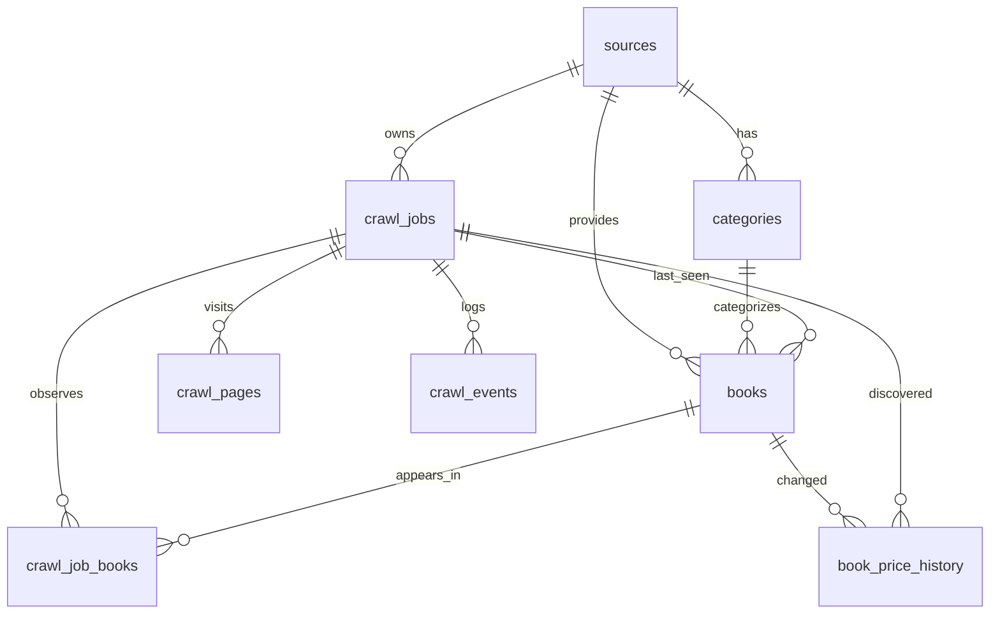

# CrawlInsight / LTW-TH — Database V3

> **Trạng thái:** Database layer có thể khởi tạo, ghi nhận crawler, xem/kiểm tra và xuất dữ liệu. Đã chạy kiểm thử SQLite offline. **Chưa phải bằng chứng đã crawl dữ liệu live.**
>
> Stack hiện tại: Python 3.11/3.12 · Flask · Scrapy · **SQLite**. Dự án nằm trong `C:\xampp\htdocs\LTW-TH` **không có nghĩa backend đã chuyển sang PHP/MySQL**. Trang được chạy qua `http://127.0.0.1:5000`, không phải `http://localhost/LTW-TH`.

## 1. Mục tiêu và nguyên tắc

Database phải trả lời được **6 câu hỏi**, không chỉ tạo bảng:

1. **Dữ liệu tới từ đâu?** → `sources`.
2. **Đang lưu những sách nào?** → `books`, liên kết `categories` và `sources`.
3. **Ai/đâu đã crawl khi nào?** → `crawl_jobs`, `crawl_pages`.
4. **Một lượt crawl tạo/cập nhật những sách nào?** → `crawl_job_books`.
5. **Sách có thay đổi giá không?** → `book_price_history` chỉ ghi khi giá thay đổi.
6. **Job có lỗi gì và được tạo/nâng cấp lúc nào?** → `crawl_events`, `schema_migrations`.

Tất cả dữ liệu chạy thật phải xuất phát từ Python Scrapy qua `src.db`, không nhét fixture vào DB đang chạy để giả vờ crawl. `database/examples/` chỉ chứa cơ sở dữ liệu và báo cáo **minh họa tổng hợp** để team học cấu trúc.

## 2. Cấu trúc các file database

```text
database/
├── README.md                    # Bắt đầu từ đây
├── DATA_DICTIONARY.md          # Từng bảng/từng trường và quan hệ
├── SQL_RECIPES.md              # Query thực tiễn để team tự kiểm tra
├── schema.sql                  # Bản SQL tổng hợp, chỉ dùng tạo DB MỚI
├── migrations/
│   ├── 001_core.sql            # 9 bảng, CHECK / UNIQUE / FK
│   ├── 002_indexes.sql         # Index tra cứu và unique active job
│   └── 003_views.sql           # 3 view đã join, có thể SELECT trực tiếp
├── tools/
│   ├── db_cli.py               # Init/migrate/check/tables/rows/describe/export/backup/demo
│   └── generate_report.py      # Sinh HTML database viewer có dữ liệu
└── examples/
    ├── CrawlInsight_DEMO.sqlite3        # 12 sách GIẢ LẬP, không dùng làm production
    └── Database_Explorer_DEMO.html      # Mở trực tiếp bằng Chrome/Edge
```

Code chịu trách nhiệm đọc/ghi là các file:

```text
src/db.py                       # API tương thích Flask và Scrapy, facade
src/database/connection.py      # Path, kết nối, timezone, foreign_keys
src/database/migrations.py      # Bootstrap và nâng cấp v2 -> v3 + sao lưu
src/database/books.py           # Validation, upsert, phân loại thay đổi, tìm kiếm
src/database/jobs.py            # Vòng đời job, trang crawl, nhật ký
src/database/analytics.py       # Thống kê cho frontend
```

Không chỉnh SQL tùy tiện trực tiếp ở `app.py`, `books_spider.py` hoặc JavaScript. Nếu thêm cột phải thêm migration version mới và kiểm thử hồi quy.

## 3. Sơ đồ quan hệ ERD



Có **9 bảng nghiệp vụ/metadata** và **3 view báo cáo**; `sqlite_sequence` là bảng nội bộ SQLite không tính vào thiết kế.

## 4. Tạo database chạy thật, không có dữ liệu sách giả

Mở **PowerShell trong thư mục `LTW-TH`**:

```powershell
# Nếu đã chạy START_HERE.bat thì môi trường đã được cài:
.\.venv\Scripts\python.exe -m database.tools.db_cli init
.\.venv\Scripts\python.exe -m database.tools.db_cli tables
.\.venv\Scripts\python.exe -m database.tools.db_cli check
.\.venv\Scripts\python.exe -m database.tools.db_cli describe books
.\.venv\Scripts\python.exe -m database.tools.db_cli rows books --limit 10
```

Trước lượt crawl đầu: `books = 0`, `crawl_jobs = 0`, `categories = 0`, `sources = 1`, `schema_migrations = 3`. Hệ thống **không tạo sẵn sách**. Sau khi chạy crawler thật thì số dòng thay đổi theo những gì thu được.

**Chuyển DB cũ khi mới đổi tên folder:** trước khi chạy phiên bản mới, nếu DB v1.0 còn nằm tại `LTW-TH\data\crawlinsight.db`, sau khi dừng các process hãy chạy `python -m database.tools.import_legacy --source "C:\xampp\htdocs\LTW-TH\data\crawlinsight.db"`. Script copy an toàn sang chỗ DB mới, không xóa file cũ hoặc ghi đè DB đích đang có.

**Đường dẫn DB runtime:**

- Nếu project nằm trong `C:\xampp\htdocs\LTW-TH`, mặc định DB lưu tại `C:\xampp\ltw-th-private-data\crawlinsight.db` (ngoài `htdocs` để Apache không đọc được).
- Nếu project ở thư mục bình thường, DB lưu trong `LTW-TH\data\crawlinsight.db`.
- Có thể đặt `CRAWLINSIGHT_DB_PATH` thành một đường dẫn **nằm ngoài public web root**. Không đổi đường dẫn giữa app và crawler đang chạy.

## 5. Xem database không phải viết query

**Phương án A — Mở ngay file ví dụ:** double-click `database/examples/Database_Explorer_DEMO.html`. Giao diện liệt kê tên bảng, đếm bản ghi, mô tả, trường và sample rows. Chú thích màu vàng xác nhận đây là **dữ liệu DEMO không crawl thật**.

**Phương án B — Xem DB runtime:**

```powershell
.\.venv\Scripts\python.exe -m database.tools.db_cli tables
.\.venv\Scripts\python.exe -m database.tools.db_cli rows v_books_detail --limit 20
.\.venv\Scripts\python.exe -m database.tools.db_cli rows v_category_summary
.\.venv\Scripts\python.exe -m database.tools.db_cli rows v_job_overview
```

**Phương án C — Sinh bản HTML từ dữ liệu crawler thật:**

```powershell
.\.venv\Scripts\python.exe -m database.tools.generate_report --db "C:\xampp\ltw-th-private-data\crawlinsight.db" --output "$env:TEMP\ltw-th-database-report.html" --limit 12
```

**Phương án D — DB Browser for SQLite:** mở file `.sqlite3` hoặc `.db` bằng [DB Browser for SQLite](https://sqlitebrowser.org/), xem tab **Database Structure** và **Browse Data**. phpMyAdmin **chỉ dành cho MySQL/MariaDB**, không đọc trực tiếp SQLite.

## 6. Chạy kiểm tra và xuất CSV

```powershell
.\.venv\Scripts\python.exe -m database.tools.db_cli check
.\.venv\Scripts\python.exe -m database.tools.db_cli export v_books_detail --format csv --output "$env:TEMP\books-export.csv"
.\.venv\Scripts\python.exe -m database.tools.db_cli export crawl_jobs --format json --output "$env:TEMP\jobs-export.json"
```

Lệnh `rows`, `tables`, `describe`, `check`, `export` **chỉ mở cơ sở dữ liệu theo chế độ read-only**. Nếu tệp chưa tồn tại, lệnh báo lỗi, không tự tạo file DB trống.

## 7. Nâng cấp từ phiên bản 2 bảng trước đây

`python -m database.tools.db_cli init` tự phát hiện schema v2 cũ (`books`, `crawl_jobs`) và tạo bản sao lưu `*.before-v3-<UTC>.sqlite3` **trước khi chuyển đổi**. Để an toàn cần **dừng Flask và crawler** trước khi upgrade. Bản ghi sách và job cũ được copy sang bảng mới, tạo `categories` phù hợp; không xóa trắng dữ liệu. Sau đó chạy `check` và so sánh row counts.

Trước khi thao tác trên database quan trọng nên tự backup chủ động:

```powershell
.\.venv\Scripts\python.exe -m database.tools.db_cli backup --output "$env:TEMP\crawlinsight-backup.sqlite3"
```

Không dùng `schema.sql` để ghi đè DB hiện có! File đó dùng đọc hoặc nhập SQL cho DB mới hoàn toàn. Migrations thông qua Python mới là luồng nâng cấp chuẩn.

## 8. SQLite bảo vệ toàn vẹn dữ liệu ra sao?

- `FOREIGN KEY`: sách không thể trỏ tới một danh mục không tồn tại.
- `UNIQUE`: một `source_url` tối đa một sách; một job chỉ một observation cho một sách; tối đa một job ở trạng thái PENDING/RUNNING nhờ partial unique index.
- `CHECK`: giá không âm, rating 1–5, max_pages 1–3, số trang đã xử lý không vượt giới hạn, counters không âm, `items_saved = new_books + existing_books`.
- **Transactions (`BEGIN IMMEDIATE`)**: thêm/cập nhật sách, tạo category, ghi audit và tăng job counter hoàn tất cùng nhau hoặc cùng rollback.
- **WAL + busy timeout**: hỗ trợ API Flask đọc cùng lúc crawler ghi, phù hợp một máy học tập.
- **Parameterized SQL**: bộ lọc/tìm kiếm không chèn raw input vào câu SQL.
- **Idempotent job item**: một sách nếu lỡ nhận hai lần trong cùng job không đếm lần thứ hai.

## 9. Giới hạn còn lại

- Chưa triển khai MySQL/phpMyAdmin — cần một phiên bản backend MySQL riêng nếu nhóm quyết định đổi stack.
- Đây là local single-machine; chưa có tài khoản, phân quyền hay dữ liệu người dùng.
- Chưa kiểm chứng crawling live từ nguồn web ở môi trường soạn file; kiểm thử offline database/fixture không thay cho live acceptance.
- Không sửa bảng SQLite bằng cách xóa `.db` khi Flask/crawler đang chạy.

Đọc tiếp: [`DATA_DICTIONARY.md`](DATA_DICTIONARY.md), [`SQL_RECIPES.md`](SQL_RECIPES.md), [`../docs/SRS_ADDENDUM_DATABASE_V3.md`](../docs/SRS_ADDENDUM_DATABASE_V3.md).

## V4 multi-user database extension

`004_identity_and_workspace.sql` introduces `users`, `user_preferences`, `bookmarks`, `saved_searches`, `password_reset_tokens`, `auth_attempts`, and a nullable `crawl_jobs.user_id`. Old V3 records and three reporting views remain intact. Existing V3 files are backed up as `*.before-v4-*.sqlite3` before migration. `database/schema.sql` is now the complete V4 reference snapshot for fresh installs. Use `python -m database.tools.db_cli tables`, `describe users`, `describe bookmarks`, `rows user_preferences`, and `check` to inspect actual structure. Keep outputs containing user emails/hashes PRIVATE.

`database/examples/Database_Explorer_DEMO.html` was regenerated from a V4 copy of the **synthetic** books database; no real account data are inserted. Avoid using it for live account sign-in or as the main runtime database.
