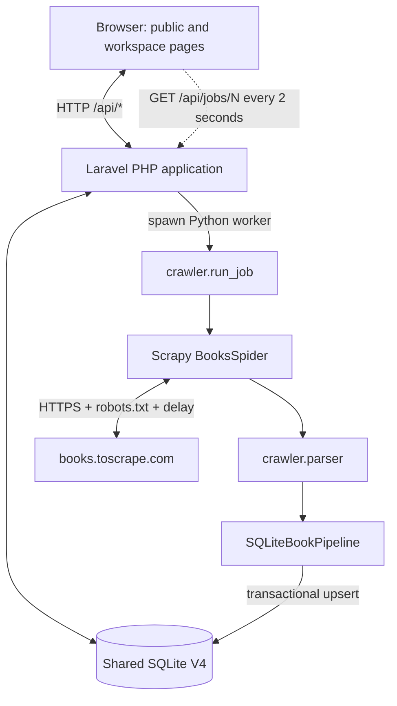

# CrawlInsight — Technical Architecture

**Current stack:** Laravel 12 / PHP 8.2+ for the web backend, Scrapy / Python 3.11–3.12 for the crawler worker, and shared SQLite V4 storage.

## 1. System overview



Laravel owns HTTP routing, session/CSRF security, templates, account and workspace services, and crawl-job creation. It starts the bounded Python worker asynchronously and serves the job state from SQLite without waiting for the crawl to finish. The crawler owns source requests, parsing, and writes of crawl results and job progress through `src.db`.

## 2. Crawl-job lifecycle

```mermaid
sequenceDiagram
  participant U as Browser
  participant W as Laravel
  participant D as SQLite
  participant R as Python worker
  participant S as Scrapy spider
  U->>W: POST /api/jobs {max_pages:1}
  W->>D: BEGIN IMMEDIATE; verify no active job; INSERT PENDING
  W->>R: python -m crawler.run_job --job-id N
  W-->>U: 202 job id / PENDING
  R->>D: PENDING -> RUNNING
  R->>S: Start spider
  S->>D: Validate, parse, upsert books and counters
  loop During run
    U->>W: GET /api/jobs/N
    W->>D: Read owner-scoped state and events
    W-->>U: Current state
  end
  R->>D: RUNNING -> COMPLETED/FAILED
```

PHP and Python must resolve `CRAWLINSIGHT_DB_PATH` to the exact same SQLite file. Laravel passes the resolved database path to the child process explicitly. If the project is under `htdocs`, the default database location is outside the served directory.

## 3. Database invariants

`books.source_url` is unique. `first_seen_at` is retained when a book is updated; `last_seen_at` records the latest upsert. `items_saved = new_books + existing_books` is enforced by a check constraint and atomic transaction. `books_found` counts detail URLs scheduled, not HTTP requests; `catalogue_pages_done` counts successfully parsed catalogue pages.

The global catalogue and source data are shared. Account preferences, bookmarks, saved searches, and jobs are user-scoped. Existing V4 SQL schema and migrations remain the database source of truth; the PHP app does not create a parallel schema.

## 4. Crawler boundaries

- Scrapy starts at the Books to Scrape catalogue and follows only validated HTTPS URLs on `books.toscrape.com`.
- Only the configured source and bounded catalogue pages are supported; there is no arbitrary URL crawling or CAPTCHA bypass.
- `ROBOTSTXT_OBEY`, one concurrent request, a one-second delay, and bounded retries remain enabled.
- Invalid responses/items update job error evidence and do not create fake books.
- The PHP service creates the job and event; the Python worker owns transitions after launch and records crawler progress/results.

## 5. Component ownership

| Concern | Owner |
|---|---|
| HTTP routes, JSON contracts, sessions, CSRF, security headers | `routes/`, `app/Http/`, Laravel middleware |
| Accounts, saved objects, book query/API operations, reset mail | `app/Services/`, `app/Http/Controllers/` |
| Server-rendered pages | `templates/` with Twig and `app/Support/TwigRenderer.php` |
| Frontend behavior | `static/js/` (shared, auth, dashboard, books, workspace pages) |
| Frontend styles | `static/css/style.css` (base), `explorer.css` (book explorer), `responsive.css` (base breakpoints), `platform.css` (theme and product UI), `platform-responsive.css` (product breakpoints) |
| Crawl requests, parsing and worker lifecycle | `crawler/` |
| Python SQLite connection and crawler persistence | `src/db.py`, `src/database/` |
| Schema and migrations | `database/schema.sql`, `database/migrations/` |

The former Flask routes and Python account implementation have been removed. `app.py` is only a compatibility launcher for `php artisan serve`; it does not implement HTTP routes.

## 6. Limitations

- No recovery daemon is included; an operating-system/process kill can leave a job marked RUNNING and requires operator inspection.
- Live source selectors, SMTP delivery, browser behavior, and Windows process launching require runtime acceptance testing.
- The application is for local academic development, not a production high-availability service.
- Books to Scrape values are educational sandbox data, not commercial data.
