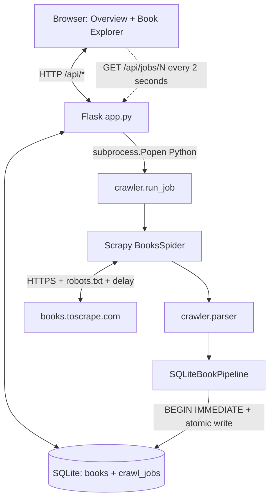

> **Database V3 note:** Cấu trúc hai bảng được thay bằng 9 bảng chuẩn hóa và 3 SQL views theo [`SRS_ADDENDUM_DATABASE_V3.md`](SRS_ADDENDUM_DATABASE_V3.md) và [`../database/DATA_DICTIONARY.md`](../database/DATA_DICTIONARY.md). API và UI contract không thay đổi.

# CrawlInsight — Technical Architecture

**SRS version:** 2.0 (10-day baseline) · **Scope:** 1 educational source / 2 screens / 2 SQLite tables.

## 1. Sơ đồ kiến trúc



Crawl bắt đầu trong child process; Flask xử lý HTTP không chờ spider chạy xong. Thống kê/count chỉ lấy từ SQLite, không sử dụng fixture trên frontend.

## 2. Luồng tạo job

```mermaid
sequenceDiagram
  participant U as Browser
  participant W as Flask
  participant D as SQLite
  participant R as Child process
  participant S as Scrapy Spider
  U->>W: POST /api/jobs {max_pages:1}
  W->>D: BEGIN IMMEDIATE; check active; INSERT PENDING; COMMIT
  W->>R: python -m crawler.run_job --job-id N
  W-->>U: 202 job id / PENDING
  R->>D: PENDING -> RUNNING
  R->>S: Start spider
  S->>S: Validate URLs / follow Next, detail links
  S->>D: Atomic upsert book + increment counters
  loop During run
    U->>W: GET /api/jobs/N (every 2s)
    W->>D: Read counters
    W-->>U: Current state
  end
  R->>D: RUNNING -> COMPLETED/FAILED
  U->>W: GET /api/summary
  W-->>U: Actual stats, 5 recent jobs
```

## 3. Database invariants

`books.source_url` UNIQUE. `first_seen_at` giữ nguyên khi update; `last_seen_at` ghi lại thời điểm upsert. `items_saved = new_books + existing_books` enforced bởi CHECK và transaction dùng `BEGIN IMMEDIATE`. `books_found` là **URL chi tiết được lên lịch**, không phải HTTP requests. `catalogue_pages_done` là **catalogue đã phân tích thành công**. Không có bảng join job-book trong phiên bản này.

## 4. Crawler steps

- Scrapy bắt đầu tại `/`, lấy `article.product_pod h3 a` (URL detail).
- Chỉ chấp nhận HTTPS host `books.toscrape.com`, đường dẫn detail bắt đầu `/catalogue/` và kết thúc `/index.html`.
- Dùng set chống lặp URL trong cùng job. Duyệt `li.next a` tối đa `max_pages` catalogue; detail dùng `div.product_main h1`, `p.price_color`, `p.star-rating`, breadcrumb category, availability, image/UPC.
- Scrapy `ROBOTSTXT_OBEY`, concurrency=1, delay=1s, retry=1; không nới hạn khi nguồn chậm.
- Nếu response/HTML lỗi, ghi error_count, loại item lỗi, không tạo sản phẩm giả. Nếu vẫn lưu được sách và spider kết thúc bình thường, job completed with warnings.

## 5. API ownership

`app.py` phụ trách HTTP validation, template route, spawn process; `src/db.py` phụ trách database. Không có SQL trong templates/JS. `crawler/parser.py` xử lý HTML thành item; `crawler/pipelines.py` chỉ dùng DB abstraction. Không có mã JS đọc file SQLite hoặc điều khiển Python trực tiếp.

## 6. Limitations

- Crawler không chạy recovery daemon; job có thể treo RUNNING sau OS/process kill, người vận hành phải xác minh và chạy `src.recover_job` thủ công.
- Source hiện có thể thay HTML; selector/unit fixtures và live acceptance test cần kiểm tra trên máy có Internet.
- Không có auth, không triển khai public, không thiết kế hiệu năng lớn/HA.
- Giá GBP và ratings là dữ liệu giả lập của sandbox; không phục vụ thực tế kinh doanh.
